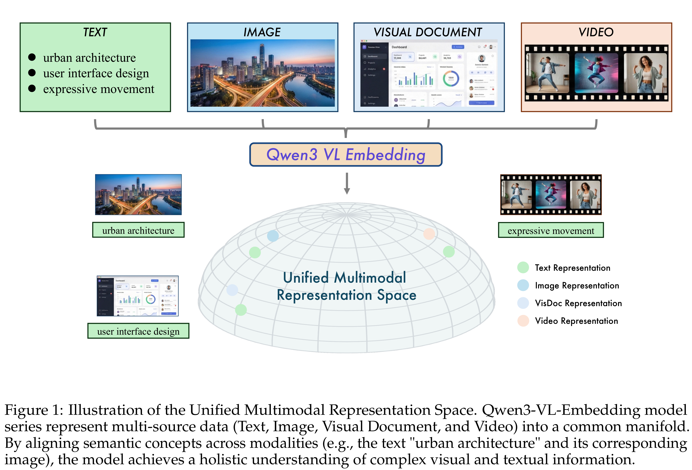
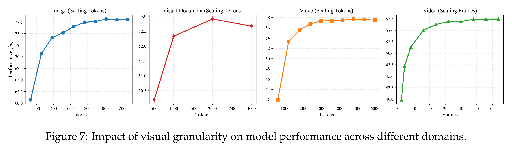

# Qwen3-VL-Embedding and Qwen3-VL-Reranker Technical Report

[Official source](https://github.com/QwenLM/Qwen3-VL-Embedding)

## Abstract

In this report, we introduce the Qwen3-VL-Embedding and Qwen3-VL-Reranker model series, the latest extensions of the Qwen family built on the Qwen3-VL foundation model. Together, they provide an end-to-end pipeline for high-precision multimodal search by mapping diverse modalities, including text, images, document images, and video, into a unified representation space. The Qwen3-VL-Embedding model employs a multi-stage training paradigm, progressing from large-scale contrastive pre-training to reranking model distillation, to generate semantically rich high-dimensional vectors. It supports Matryoshka Representation Learning, enabling flexible embedding dimensions, and handles inputs up to 32k tokens. Complementing this, Qwen3-VL-Reranker performs fine-grained relevance estimation for query-document pairs using a cross-encoder architecture with cross-attention mechanisms. Both model series inherit the multilingual capabilities of Qwen3-VL, supporting more than 30 languages, and are released in 2B and 8B parameter sizes to accommodate diverse deployment requirements. Empirical evaluations demonstrate that the Qwen3-VL-Embedding series achieves state-of-the-art results across diverse multimodal embedding evaluation benchmarks. Specifically, Qwen3-VL-Embedding-8B attains an overall score of 77.8 on MMEB-V2, ranking first among all models (as of January 8, 2025). This report presents the architecture, training methodology, and practical capabilities of the series, demonstrating their effectiveness on various multimodal retrieval tasks, including image-text retrieval, visual question answering, and video-text matching.

Figure 1: Illustration of the Unified Multimodal Representation Space. Qwen3-VL-Embedding model series represent multi-source data (Text, Image, Visual Document, and Video) into a common manifold. By aligning semantic concepts across modalities (e.g., the text "urban architecture" and its corresponding image), the model achieves a holistic understanding of complex visual and textual information.

p. 2

Figure 7: Impact of visual granularity on model performance across different domains.

p. 13
