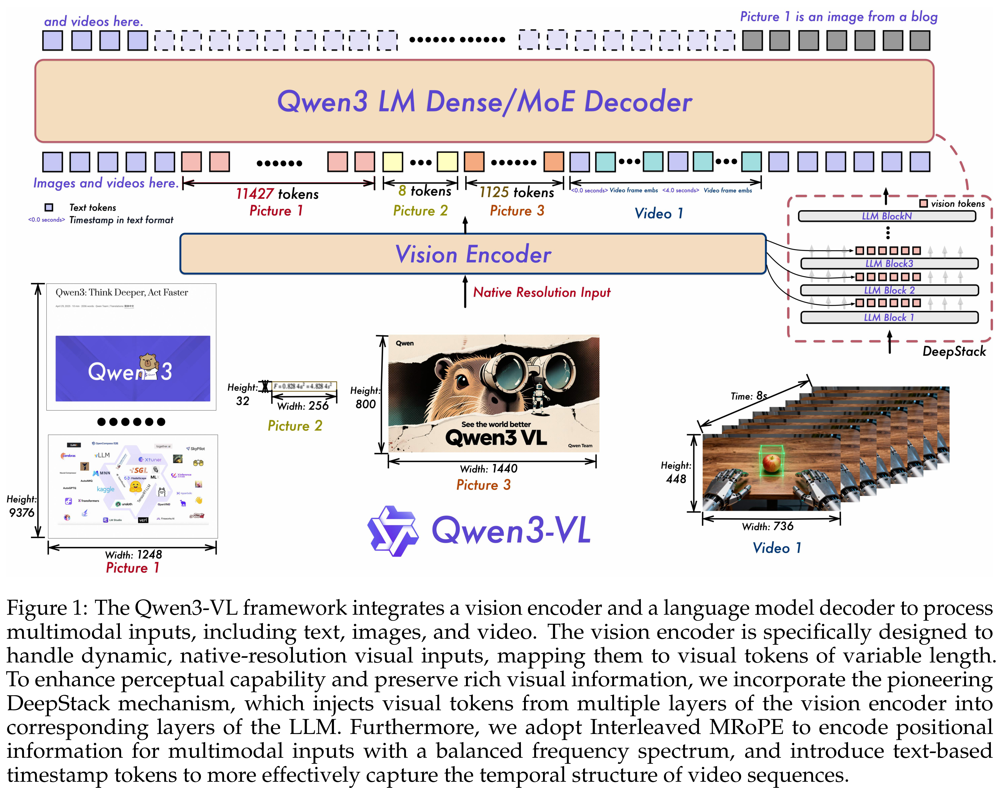
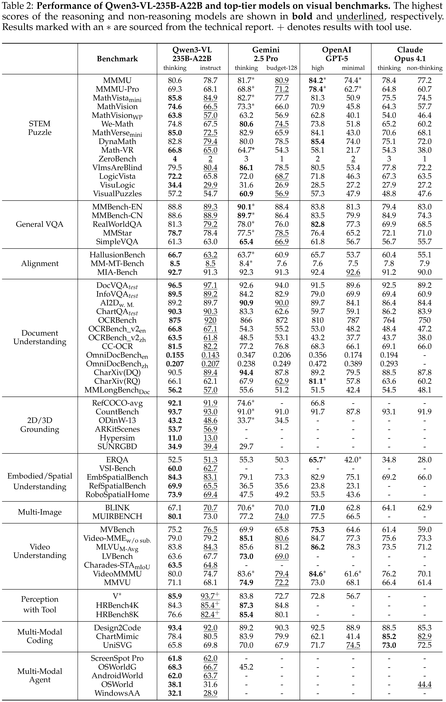

# Qwen3-VL Technical Report

[Official source](https://github.com/QwenLM/Qwen3-VL)

## Abstract

We introduce Qwen3-VL, the most capable vision–language model in the Qwen series to date, achieving superior performance across a broad range of multimodal benchmarks. It natively supports interleaved contexts of up to 256K tokens, seamlessly integrat- ing text, images, and video. The model family includes both dense (2B/4B/8B/32B) and mixture-of-experts (30B-A3B/235B-A22B) variants to accommodate diverse la- tency–quality trade-offs. Qwen3-VL delivers three core pillars: (i) markedly stronger pure-text understanding, surpassing comparable text-only backbones in several cases; (ii) robust long-context comprehension with a native 256K-token window for both text and interleaved multimodal inputs, enabling faithful retention, retrieval, and cross- referencing across long documents and videos; and (iii) advanced multimodal reasoning across single-image, multi-image, and video tasks, demonstrating leading performance on comprehensive evaluations such as MMMU and visual-math benchmarks (e.g., Math- Vista and MathVision). Architecturally, we introduce three key upgrades: (i) an enhanced interleaved-MRoPE for stronger spatial–temporal modeling across images and video; (ii) DeepStack integration, which effectively leverages multi-level ViT features to tighten vision–language alignment; and (iii) text-based time alignment for video, evolving from T-RoPE to explicit textual timestamp alignment for more precise temporal grounding. To balance text-only and multimodal learning objectives, we apply square-root reweight- ing, which boosts multimodal performance without compromising text capabilities. We extend pretraining to a context length of 256K tokens and bifurcate post-training into non-thinking and thinking variants to address distinct application requirements. Furthermore, we allocate additional compute resources to the post-training phase to further enhance model performance. Under comparable token budgets and latency constraints, Qwen3-VL achieves superior performance in both dense and Mixture-of- Experts (MoE) architectures. We envision Qwen3-VL serving as a foundational engine for image-grounded reasoning, agentic decision-making, and multimodal code intelligence in real-world workflows.

Figure 1: The Qwen3-VL framework integrates a vision encoder and a language model decoder to process
multimodal inputs, including text, images, and video. The vision encoder is specifically designed to
handle dynamic, native-resolution visual inputs, mapping them to visual tokens of variable length.
To enhance perceptual capability and preserve rich visual information, we incorporate the pioneering
DeepStack mechanism, which injects visual tokens from multiple layers of the vision encoder into
corresponding layers of the LLM. Furthermore, we adopt Interleaved MRoPE to encode positional
information for multimodal inputs with a balanced frequency spectrum, and introduce text-based
timestamp tokens to more effectively capture the temporal structure of video sequences.

p. 3

Table 2: Performance of Qwen3-VL-235B-A22B and top-tier models on visual benchmarks. The highest
scores of the reasoning and non-reasoning models are shown in bold and underlined, respectively.
Results marked with an ∗are sourced from the technical report. + denotes results with tool use.

p. 15
