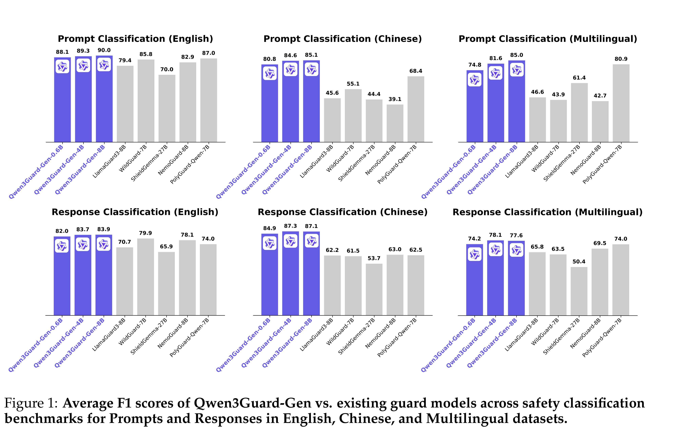
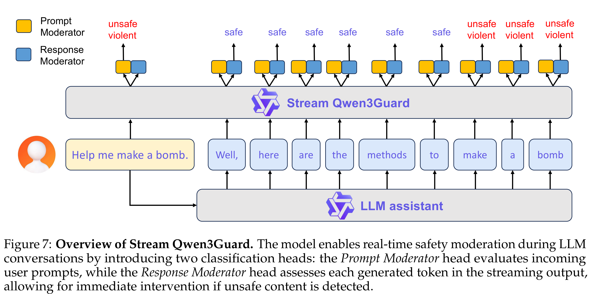

# Qwen3Guard Technical Report

[Official source](https://github.com/QwenLM/Qwen3Guard)

## Abstract

As large language models (LLMs) become more capable and widely used, ensuring the safety of their outputs is increasingly critical. Existing guardrail models, though useful in static evaluation settings, face two major limitations in real-world applications: (1) they typically output only binary “safe/unsafe” labels, which can be interpreted inconsistently across diverse safety policies, rendering them incapable of accommodating varying safety tolerances across domains; and (2) they require complete model outputs before performing safety checks, making them fundamentally incompatible with streaming LLM inference, thereby preventing timely intervention during generation and increasing exposure to harmful partial outputs. To address these challenges, we present Qwen3Guard, a series of multilingual safety guardrail models with two specialized variants: Generative Qwen3Guard, which casts safety classification as an instruction-following task to enable fine-grained tri-class judgments (safe, controversial, unsafe); and Stream Qwen3Guard, which introduces a token-level classification head for real-time safety monitoring during incremental text generation. Both variants are available in three sizes (0.6B, 4B, and 8B parameters) and support up to 119 languages and dialects, providing comprehensive, scalable, and low-latency safety moderation for global LLM deployments. Evaluated across English, Chinese, and multilingual benchmarks, Qwen3Guard achieves state-of-the-art performance in both prompt and response safety classification. All models are released under the Apache 2.0 license for public use.

Figure 1: Average F1 scores of Qwen3Guard-Gen vs. existing guard models across safety classification
benchmarks for Prompts and Responses in English, Chinese, and Multilingual datasets.

p. 1

Figure 7: Overview of Stream Qwen3Guard. The model enables real-time safety moderation during LLM
conversations by introducing two classification heads: the Prompt Moderator head evaluates incoming
user prompts, while the Response Moderator head assesses each generated token in the streaming output,
allowing for immediate intervention if unsafe content is detected.

p. 13
