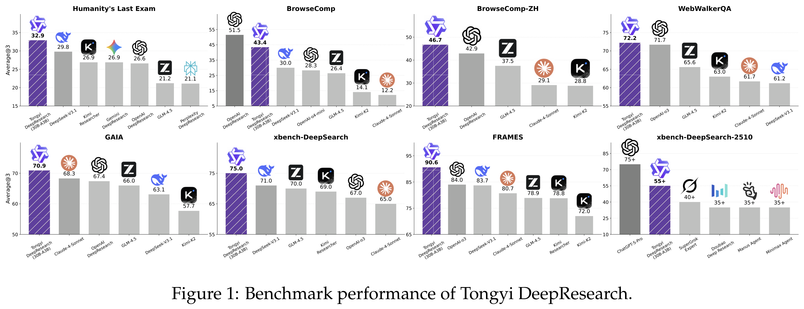
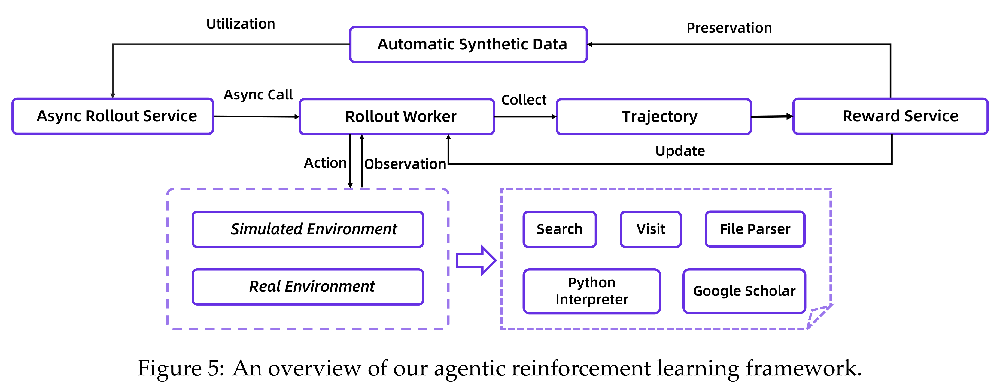

# Tongyi DeepResearch Technical Report

[Official source](https://arxiv.org/abs/2510.24701)

## Abstract

We present Tongyi DeepResearch, an agentic large language model, which is specifically designed for long-horizon, deep information-seeking research tasks. To incentivize autonomous deep research agency, Tongyi DeepResearch is developed through an end-to-end training framework that combines agen- tic mid-training and agentic post-training, enabling scalable reasoning and information seeking across complex tasks. We design a highly scalable data synthesis pipeline that is fully automatic, without relying on costly human annotation, and empowers all training stages. By constructing customized environments for each stage, our system enables stable and consistent interac- tions throughout. Tongyi DeepResearch, featuring 30.5 billion total parameters, with only 3.3 billion activated per token, achieves state-of-the-art performance across a range of agentic deep research benchmarks, including Humanity’s Last Exam, BrowseComp, BrowseComp-ZH, WebWalkerQA, xbench-DeepSearch, FRAMES and xbench-DeepSearch-2510. We open-source the model, frame- work, and complete solutions to empower the community.

Figure 1: Benchmark performance of Tongyi DeepResearch.

p. 1

Figure 5: An overview of our agentic reinforcement learning framework.

p. 9
