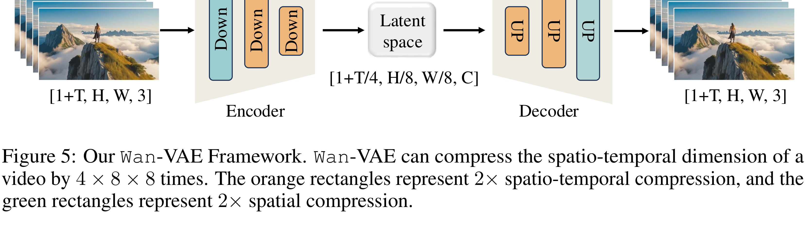

# Wan: Open and Advanced Large-Scale Video Generative Models

[Official source](https://arxiv.org/abs/2503.20314)

## ABSTRACT

This report presents Wan, a comprehensive and open suite of video foundation models designed to push the boundaries of video generation. Built upon the mainstream diffusion transformer paradigm, Wan achieves significant advancements in generative capabilities through a series of innovations, including our novel spatio-temporal variational autoencoder (VAE), scalable pre-training strategies, large-scale data curation, and automated evaluation metrics. These contributions collectively enhance the model’s performance and versatility. Specifically, Wan is characterized by four key features: Leading Performance: The 14B model of Wan, trained on a vast dataset comprising billions of images and videos, demonstrates the scaling laws of video generation with respect to both data and model size. It consistently outperforms the existing open-source models as well as state-of-the-art commercial solutions across multiple internal and external benchmarks, demonstrating a clear and significant performance superiority. Comprehensiveness: Wan offers two capable models, i.e., 1.3B and 14B parameters, for efficiency and effectiveness respectively. It also covers multiple downstream applications, including image-to-video, instruction-guided video editing, and personal video generation, encompassing up to eight tasks. Meanwhile, Wan is the first model that can generate visual text in both Chinese and English, significantly enhancing its practical value. Consumer-Grade Efficiency: The 1.3B model demonstrates exceptional resource efficiency, requiring only 8.19 GB VRAM, making it compatible with a wide range of consumer-grade GPUs. It also exhibits superior performance compared to larger open-source models, showcasing remarkable efficiency for text-to-video. Openness: We open-source the entire series of Wan, including source code and all models, with the goal of fostering the growth of the video generation community. This openness seeks to significantly expand the creative possibilities of video production in the industry and provide academia with high-quality video foundation models. In addition, we conduct extensive experimental analyses covering various aspects of the proposed Wan, presenting detailed results and insights. We believe these findings and conclusions will significantly advance video generation technology. All the code and models are available at https://github.com/Wan-Video/Wan2.1.

Figure 5: Our Wan-VAE Framework. Wan-VAE can compress the spatio-temporal dimension of a video by 4 × 8 × 8 times. The orange rectangles represent 2× spatio-temporal compression, and the green rectangles represent 2× spatial compression.

p. 10
