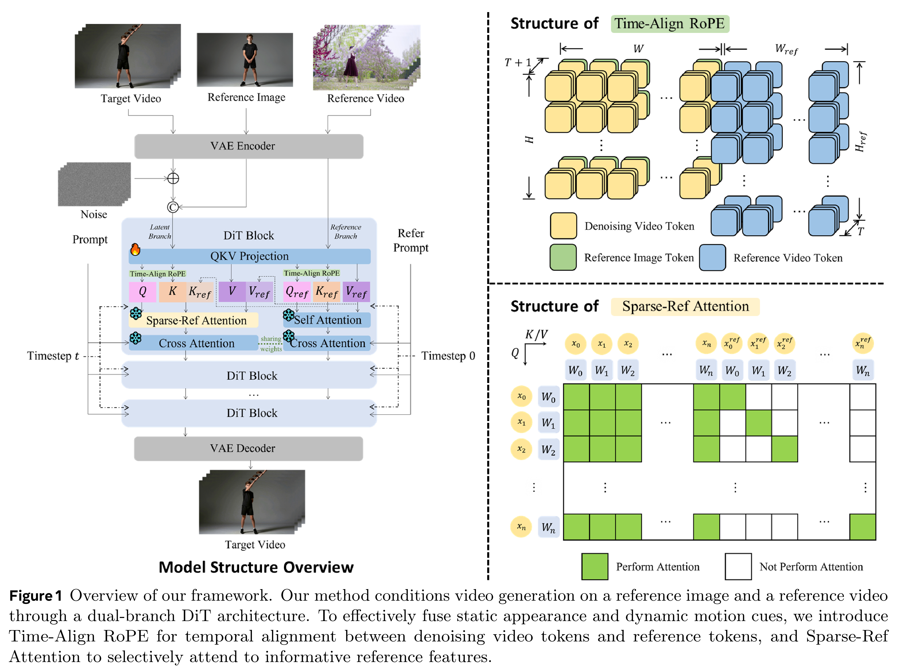
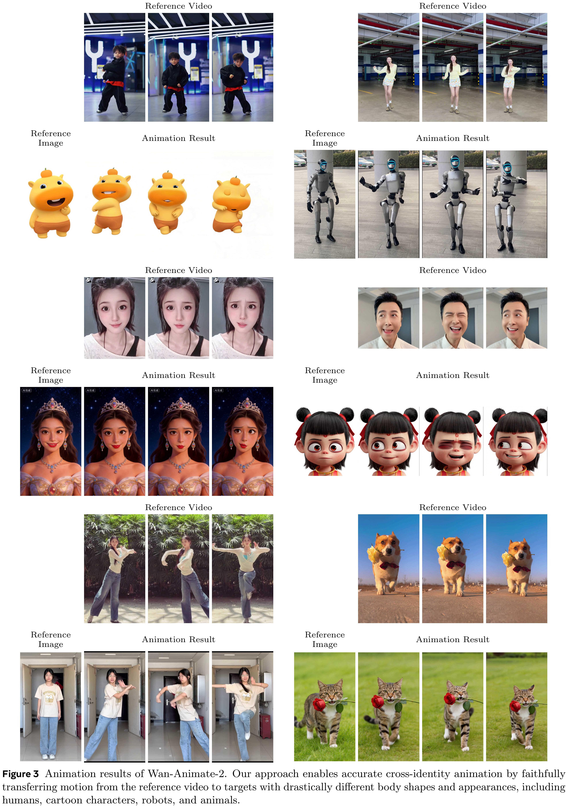

# Wan-Animate-2: Pushing the Application Boundaries of Character Animation

[Official source](https://arxiv.org/abs/2608.06009)

## 3.1 Overview

A fundamental challenge in character image animation lies in effectively integrating motion dynamics from a reference video into the generative process without relying on error-prone intermediate representations or incurring prohibitive computational costs. Wan-Animate-2 addresses this by reformulating animation as a direct video-conditioned generation task within a Diffusion Transformer (DiT). Our architecture consists of four key components: a Dual-Branch DiT that decouples reference and latent streams for efficient condition injection; a Time-Align RoPE that ensures precise spatio-temporal alignment across branches; a Sparse-Ref Attention that exploits temporal correspondence to reduce computational overhead; and an optional Viewpoint LoRA that enables text-driven camera control. The overall pipeline is illustrated in Figure 1.

Figure 1 Overview of our framework. Our method conditions video generation on a reference image and a reference video
through a dual-branch DiT architecture. To effectively fuse static appearance and dynamic motion cues, we introduce
Time-Align RoPE for temporal alignment between denoising video tokens and reference tokens, and Sparse-Ref
Attention to selectively attend to informative reference features.

p. 5

Figure 3 Animation results of Wan-Animate-2. Our approach enables accurate cross-identity animation by faithfully
transferring motion from the reference video to targets with drastically different body shapes and appearances, including
humans, cartoon characters, robots, and animals.

p. 9
