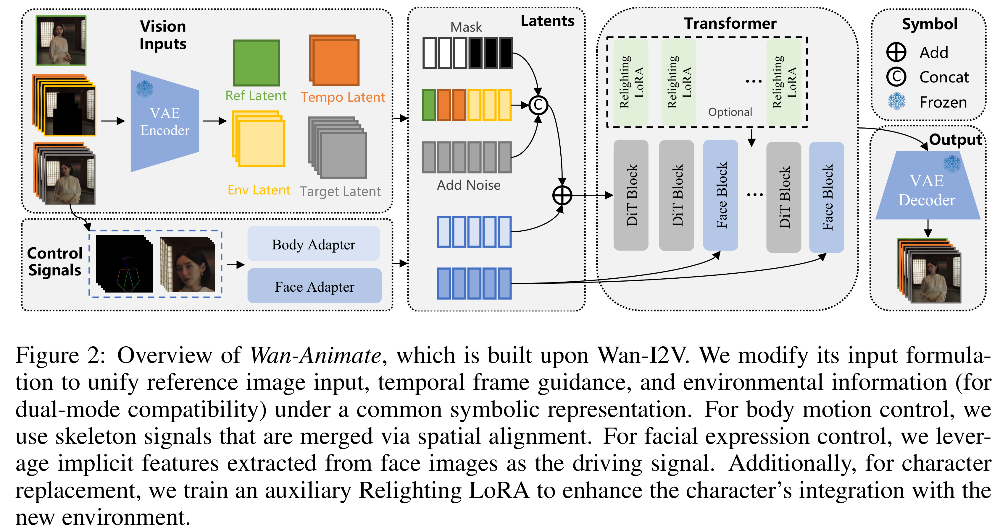
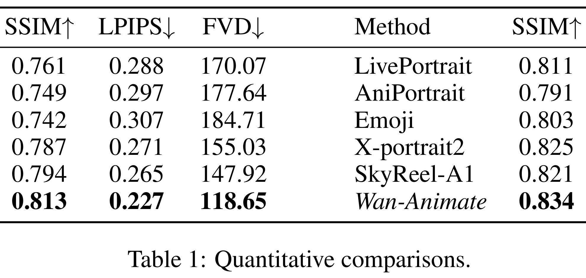

# Wan-Animate: Unified Character Animation and Replacement with Holistic Replication

[Official source](https://arxiv.org/abs/2509.14055)

## ABSTRACT

We introduce Wan-Animate, a unified framework for character animation and re- placement. Given a character image and a reference video, Wan-Animate can animate the character by precisely replicating the expressions and movements of the character in the video to generate high-fidelity character videos. Alternatively, it can integrate the animated character into the reference video to replace the orig- inal character, replicating the scene’s lighting and color tone to achieve seamless environmental integration. Wan-Animate is built upon the Wan model. To adapt it for character animation tasks, we employ a modified input paradigm to differen- tiate between reference conditions and regions for generation. This design unifies multiple tasks into a common symbolic representation. We use spatially-aligned skeleton signals to replicate body motion and implicit facial features extracted from source images to reenact expressions, enabling the generation of charac- ter videos with high controllability and expressiveness. Furthermore, to enhance environmental integration during character replacement, we develop an auxiliary Relighting LoRA. This module preserves the character’s appearance consistency while applying the appropriate environmental lighting and color tone. Experimen- tal results demonstrate that Wan-Animate achieves state-of-the-art performance. We are committed to open-sourcing the model weights and its source code. Project Page: https://humanaigc.github.io/wan-animate/

Figure 2: Overview of Wan-Animate, which is built upon Wan-I2V. We modify its input formula-
tion to unify reference image input, temporal frame guidance, and environmental information (for
dual-mode compatibility) under a common symbolic representation. For body motion control, we
use skeleton signals that are merged via spatial alignment. For facial expression control, we lever-
age implicit features extracted from face images as the driving signal. Additionally, for character
replacement, we train an auxiliary Relighting LoRA to enhance the character’s integration with the
new environment.

p. 4

Table 1: Quantitative comparisons.

p. 9
