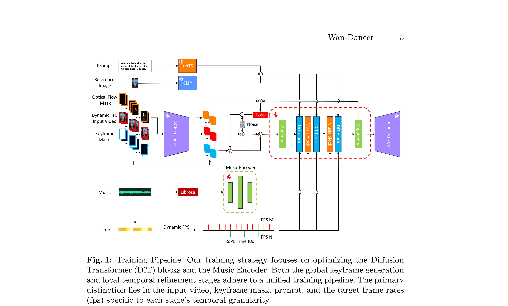
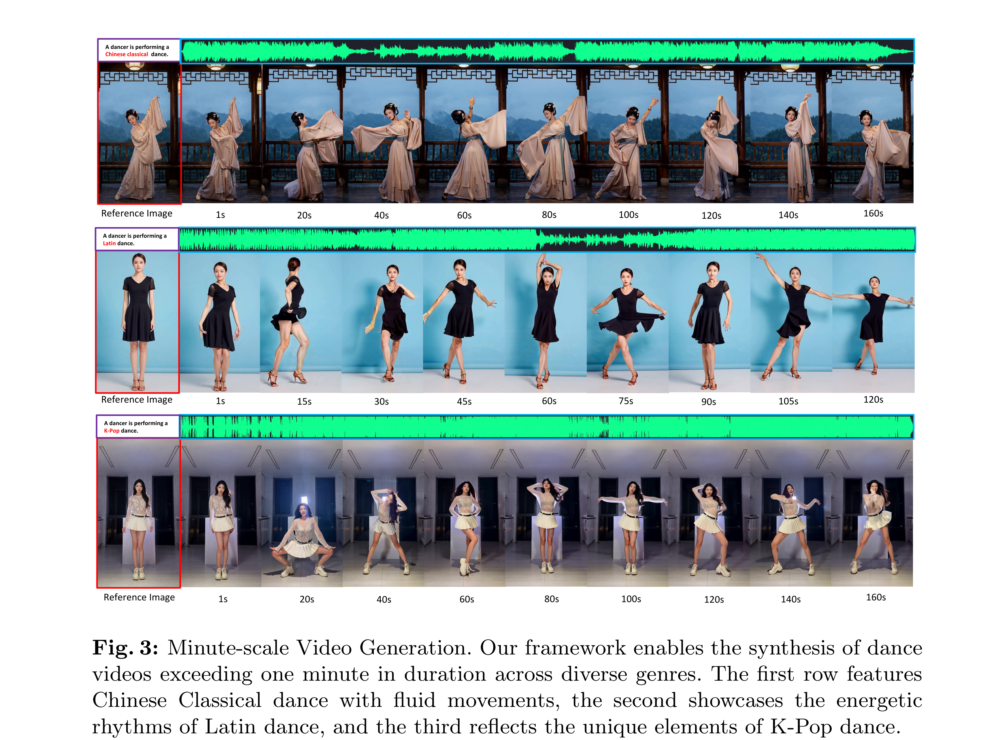

# Wan-Dancer: A Hierarchical Framework for Minute-scale Coherent Music-to-Dance Generation

[Official source](https://arxiv.org/abs/2607.09581)

## Abstract.

Generating long-duration, high-definition, and rhythmically synchronized dance videos directly from music remains a significant challenge, primarily due to the temporal constraints of current diffusion models, which typically fail beyond 20 seconds. Existing approaches, whether they rely on intermediate 3D skeletons or on end-to-end video synthesis, suffer from temporal drift, identity inconsistency, and repetitive motion patterns when extended to longer horizons. To address these limitations, we propose a novel hierarchical framework for minute-scale coherent music-to-dance generation. Our method decouples the process into global keyframe planning and local temporal refinement, leveraging full-track musical context to ensure long-range coherence. Key innovations include dynamic frame rate adaptation via time-mapped RoPE embeddings for precise alignment, an optical-flow-based loss function to enhance motion continuity, and motion-speed control to preserve high-fidelity details during rapid movements. Extensive experiments demonstrate that our framework surpasses the conventional duration barrier, generating stable, 720p/30fps videos exceeding one minute with superior temporal stability. Furthermore, the model exhibits robust versatility across five distinct dance genres, conditioned on both audio and textual prompts, establishing a new state-of-the-art in coherent, long-form dance video synthesis.

Keywords: Video Generation · Music-to-Dance · Global-to-Local · Minute-scale

Fig. 1: Training Pipeline. Our training strategy focuses on optimizing the Diffusion Transformer (DiT) blocks and the Music Encoder. Both the global keyframe generation and local temporal refinement stages adhere to a unified training pipeline. The primary distinction lies in the input video, keyframe mask, prompt, and the target frame rates (fps) specific to each stage’s temporal granularity.

p. 5

Fig. 3: Minute-scale Video Generation. Our framework enables the synthesis of dance videos exceeding one minute in duration across diverse genres. The first row features Chinese Classical dance with fluid movements, the second showcases the energetic rhythms of Latin dance, and the third reflects the unique elements of K-Pop dance.

p. 9
