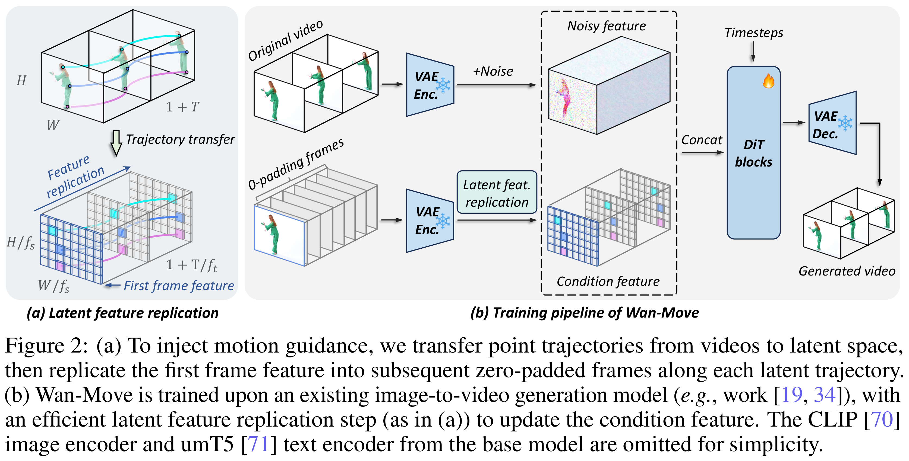
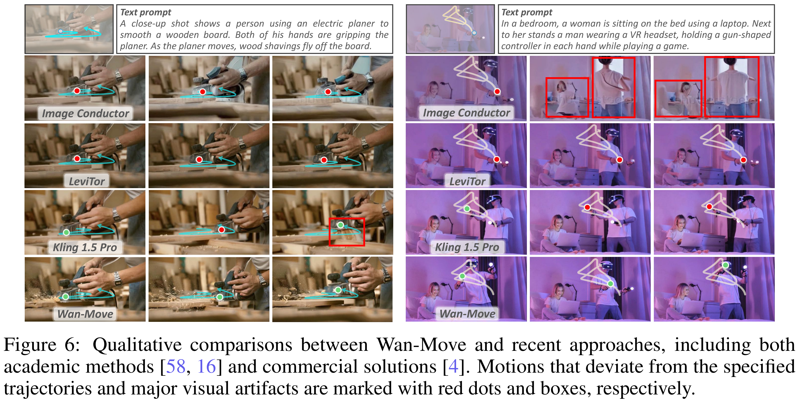

# Wan-Move: Motion-controllable Video Generation via Latent Trajectory Guidance

[Official source](https://arxiv.org/abs/2512.08765)

## Abstract

We present Wan-Move, a simple and scalable framework that brings motion control to video generative models. Existing motion-controllable methods typically suffer from coarse control granularity and limited scalability, leaving their outputs insufficient for practical use. We narrow this gap by achieving precise and high-quality motion control. Our core idea is to directly make the original condition features motion-aware for guiding video synthesis. To this end, we first represent object motions with dense point trajectories, allowing fine-grained control over the scene. We then project these trajectories into latent space and propagate the first frame’s features along each trajectory, producing an aligned spatiotemporal feature map that tells how each scene element should move. This feature map serves as the updated latent condition, which is naturally integrated into the off-the-shelf image-to-video model, e.g., Wan-I2V-14B, as motion guidance without any architecture change. It removes the need for auxiliary motion encoders and makes fine-tuning base models easily scalable. Through scaled training, Wan-Move generates 5-second, 480p videos whose motion controllability rivals Kling 1.5 Pro’s commercial Motion Brush, as indicated by user studies. To support comprehensive evaluation, we further design MoveBench, a rigorously curated benchmark featuring diverse content categories and hybrid-verified annotations. It is distinguished by larger data volume, longer video durations, and high-quality motion annotations. Extensive experiments on MoveBench and the public dataset consistently show Wan-Move’s superior motion quality. Code, models, and benchmark data are made available.

Figure 2: (a) To inject motion guidance, we transfer point trajectories from videos to latent space, then replicate the first frame feature into subsequent zero-padded frames along each latent trajectory. (b) Wan-Move is trained upon an existing image-to-video generation model (e.g., work [19, 34]), with an efficient latent feature replication step (as in (a)) to update the condition feature. The CLIP [70] image encoder and umT5 [71] text encoder from the base model are omitted for simplicity.

p. 4

Figure 6: Qualitative comparisons between Wan-Move and recent approaches, including both academic methods [58, 16] and commercial solutions [4]. Motions that deviate from the specified trajectories and major visual artifacts are marked with red dots and boxes, respectively.

p. 7
