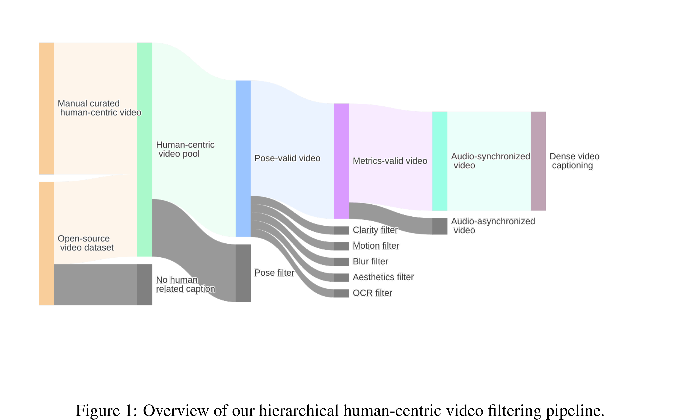
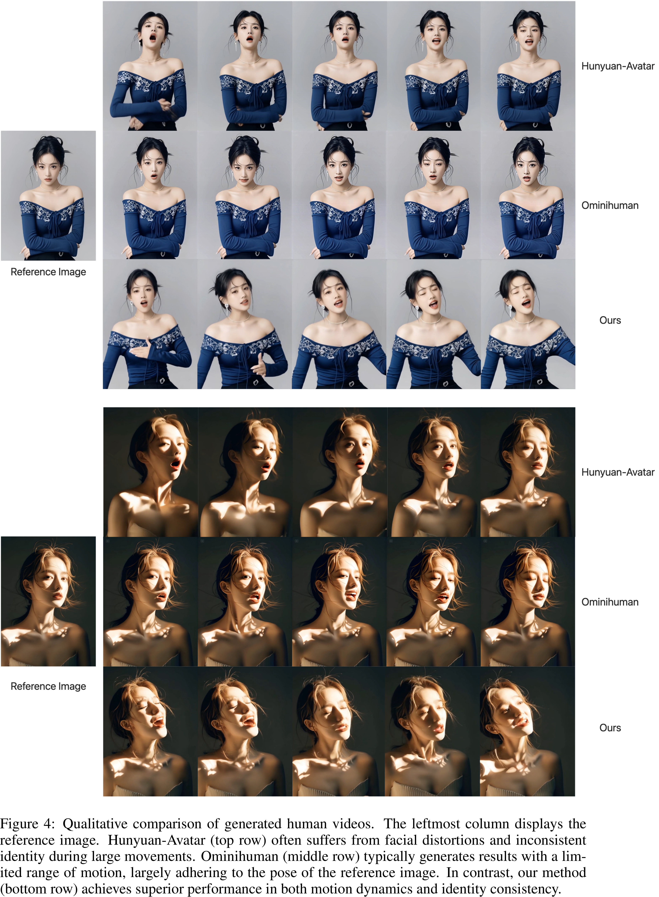

# Wan-S2V: Audio-Driven Cinematic Video Generation

[Official source](https://arxiv.org/abs/2508.18621)

## ABSTRACT

Current state-of-the-art (SOTA) methods for audio-driven character animation demonstrate promising performance for scenarios primarily involving speech and singing. However, they often fall short in more complex film and television pro- ductions, which demand sophisticated elements such as nuanced character inter- actions, realistic body movements, and dynamic camera work. To address this long-standing challenge of achieving film-level character animation, we propose an audio-driven model, which we refere to as Wan-S2V, built upon Wan. Our model achieves significantly enhanced expressiveness and fidelity in cinematic contexts compared to existing approaches. We conducted extensive experiments, benchmarking our method against cutting- edge models such as Hunyuan-Avatar and Omnihuman. The experimental results consistently demonstrate that our approach significantly outperforms these exist- ing solutions. Additionally, we explore the versatility of our method through its applications in long-form video generation and precise video lip-sync editing.

Figure 1: Overview of our hierarchical human-centric video filtering pipeline.

p. 3

Figure 4: Qualitative comparison of generated human videos. The leftmost column displays the
reference image. Hunyuan-Avatar (top row) often suffers from facial distortions and inconsistent
identity during large movements. Ominihuman (middle row) typically generates results with a lim-
ited range of motion, largely adhering to the pose of the reference image. In contrast, our method
(bottom row) achieves superior performance in both motion dynamics and identity consistency.

p. 7
