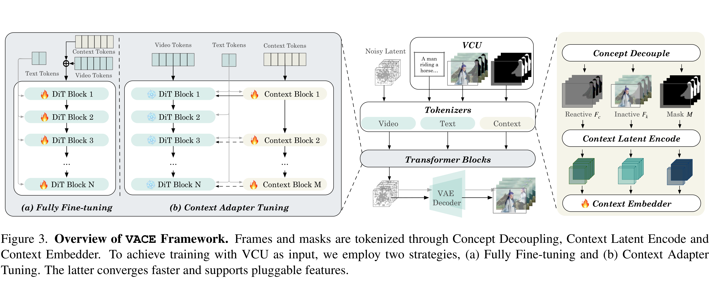

# VACE: All-in-One Video Creation and Editing

[Official source](https://arxiv.org/abs/2503.07598)

## Abstract

Diffusion Transformer has demonstrated powerful capability and scalability in generating high-quality images and videos. Further pursuing the unification of generation and editing tasks has yielded significant progress in the domain of image content creation. However, due to the intrinsic demands for consistency across both temporal and spatial dynamics, achieving a unified approach for video synthesis remains challenging. We introduce VACE, which enables users to perform Video tasks within an All-in-one framework for Creation and Editing. These tasks include reference-to-video generation, video-to-video editing, and masked video-to-video editing. Specifically, we effectively

integrate the requirements of various tasks by organizing video task inputs, such as editing, reference, and masking, into a unified interface referred to as the Video Condition Unit (VCU). Furthermore, by utilizing a Context Adapter structure, we inject different task concepts into the model using formalized representations of temporal and spatial dimensions, allowing it to handle arbitrary video synthesis tasks flexibly. Extensive experiments demonstrate that the unified model of VACE achieves performance on par with task-specific models across various subtasks. Simultaneously, it enables diverse applications through versatile task combinations. Project page: https://ali-vilab.github.io/VACE-Page/.

Figure 3. Overview of VACE Framework. Frames and masks are tokenized through Concept Decoupling, Context Latent Encode and Context Embedder. To achieve training with VCU as input, we employ two strategies, (a) Fully Fine-tuning and (b) Context Adapter Tuning. The latter converges faster and supports pluggable features.

p. 4
