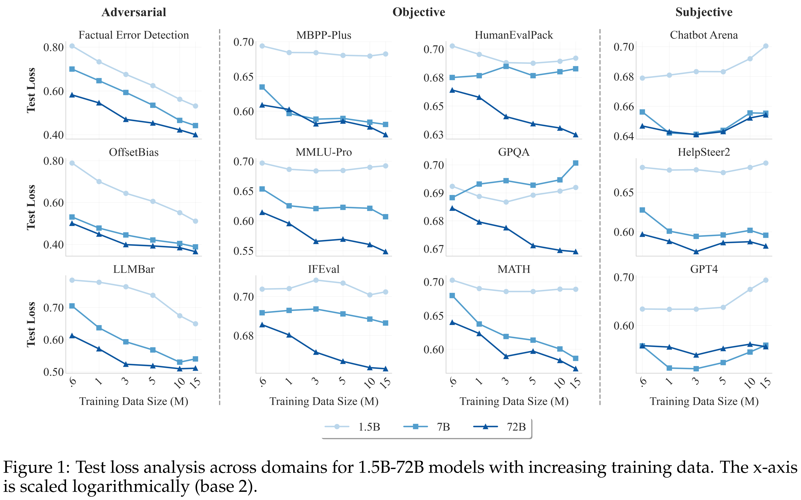
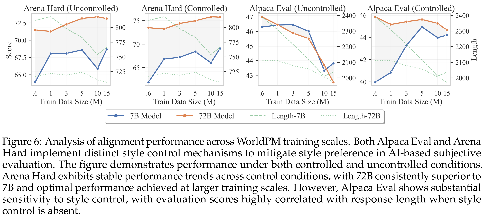

# WorldPM: Scaling Human Preference Modeling

[Official source](https://arxiv.org/abs/2505.10527)

## Abstract

Motivated by scaling laws in language modeling that demonstrate how test loss scales as a power law with model and dataset sizes, we find that similar laws exist in preference modeling. We propose World Preference Modeling (WorldPM) to emphasize this scaling potential, where World Preference embodies a unified representation of human prefer- ences. In this paper, we collect preference data from public forums covering diverse user communities, and conduct extensive training using 15M-scale data across models ranging from 1.5B to 72B parameters. We observe distinct patterns across different evaluation metrics: (1) Adversarial metrics (ability to identify deceptive features) consis- tently scale up with increased training data and base model size; (2) Objective metrics (objective knowledge with well-defined answers) show emergent behavior in larger language models, highlighting WorldPM’s scalability potential; (3) Subjective metrics (subjective preferences from a limited number of humans or AI) do not demonstrate scaling trends. Further experiments validate the effectiveness of WorldPM as a founda- tion for preference fine-tuning. Through evaluations on 7 benchmarks with 20 subtasks, we find that WorldPM broadly improves the generalization performance across human preference datasets of varying sizes (7K, 100K and 800K samples), with performance gains exceeding 5% on many key subtasks. Integrating WorldPM into our internal RLHF pipeline, we observe significant improvements on both in-house and public evaluation sets, with notable gains of 4% to 8% in our in-house evaluations.

Figure 1: Test loss analysis across domains for 1.5B-72B models with increasing training data. The x-axis is scaled logarithmically (base 2).

p. 1

Figure 6: Analysis of alignment performance across WorldPM training scales. Both Alpaca Eval and Arena Hard implement distinct style control mechanisms to mitigate style preference in AI-based subjective evaluation. The figure demonstrates performance under both controlled and uncontrolled conditions. Arena Hard exhibits stable performance trends across control conditions, with 72B consistently superior to 7B and optimal performance achieved at larger training scales. However, Alpaca Eval shows substantial sensitivity to style control, with evaluation scores highly correlated with response length when style control is absent.

p. 10
