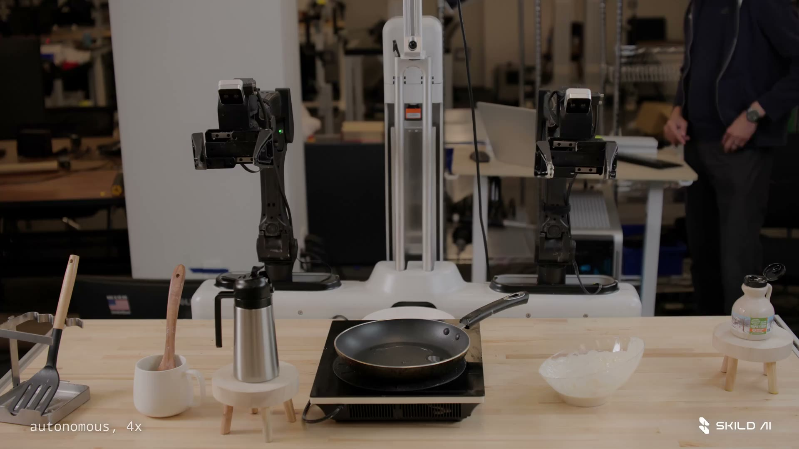

# S1

[Official source](https://skild.ai/blogs/s1)

## S1: An In-Context Learner

One year ago, we released an in-context learner for locomotion that adapts by accumulating live experience in its prompt (Liu et al., 2025). Today we are sharing manipulation results from our flagship robotic foundation model S1, built from the ground up as an in-context learner. Show it a video of a task, short or long, seen or unseen, and it executes.

This post is the first in a series we will release over the coming months; today's focus is on analyzing the in-context learning capabilities of S1, and future posts will go into depth on how S1 is trained.

