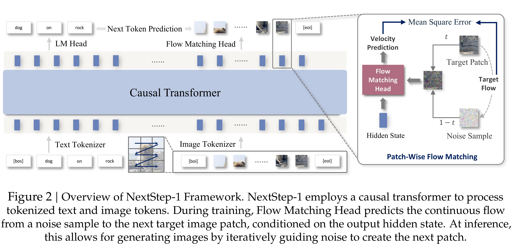

# NextStep-1: Toward Autoregressive Image Generation with Continuous Tokens at Scale

[Official source](https://github.com/stepfun-ai/NextStep-1)

## Abstract

Prevailing autoregressive (AR) models for text-to-image generation either rely on heavy, computationally-intensive diffusion models to process continuous image tokens, or employ vector quantization (VQ) to obtain discrete tokens with quantization loss. In this paper, we push the autoregressive paradigm forward with NextStep-1, a 14B autoregressive model paired with a 157M flow matching head, training on discrete text tokens and continuous image tokens with next-token prediction objectives. NextStep-1 achieves state-of-the-art performance for autoregressive models in text-to-image generation tasks, exhibiting strong capabilities in high-fidelity image synthesis. Furthermore, our method shows strong performance in image editing, highlighting the power and versatility of our unified approach. To facilitate open research, we will release our code and models to the community.

Figure 2 | Overview of NextStep-1 Framework. NextStep-1 employs a causal transformer to process tokenized text and image tokens. During training, Flow Matching Head predicts the continuous flow from a noise sample to the next target image patch, conditioned on the output hidden state. At inference,

p. 3
