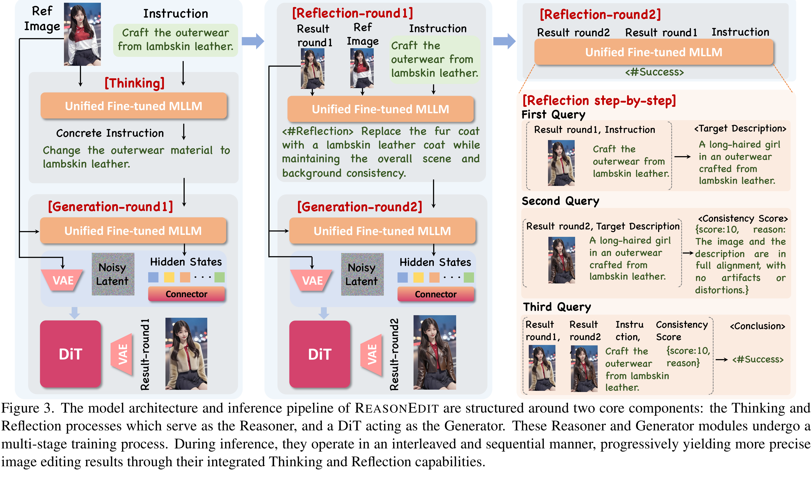

# ReasonEdit: Towards Reasoning-Enhanced Image Editing Models

[Official source](https://github.com/stepfun-ai/Step1X-Edit)

## Abstract

Recent advances in image editing models have shown remarkable progress. A common architectural design couples a multimodal large language model (MLLM) encoder with a diffusion decoder, as seen in systems such as Step1X-Edit and Qwen-Image-Edit, where the MLLM encodes both the reference image and the instruction but remains frozen during training. In this work, we demonstrate that unlocking the reasoning capabilities of MLLM can further push the boundaries of editing models. Specifically, we explore two reasoning mechanisms, thinking and reflection, which enhance instruction understanding and editing accuracy. Based on that, our proposed framework enables image editing in a thinking–editing–reflection loop: the thinking mechanism leverages the world knowledge of MLLM to interpret abstract instructions, while the reflection reviews editing results, automatically corrects unintended manipulations, and identifies the stopping round. Extensive experiments demonstrate that our reasoning approach achieves significant performance gains, with improvements of ImgEdit (+4.3%), GEdit (+4.7%), and Kris (+8.2%) when initializing our DiT from the Step1X- Edit (ReasonEdit-S), and also outperforms previous open-source methods on both GEdit and Kris when integrated with Qwen-Image-Edit (ReasonEdit-Q).

Figure 3. The model architecture and inference pipeline of REASONEDIT are structured around two core components: the Thinking and Reflection processes which serve as the Reasoner, and a DiT acting as the Generator. These Reasoner and Generator modules undergo a multi-stage training process. During inference, they operate in an interleaved and sequential manner, progressively yielding more precise image editing results through their integrated Thinking and Reflection capabilities.

p. 5
