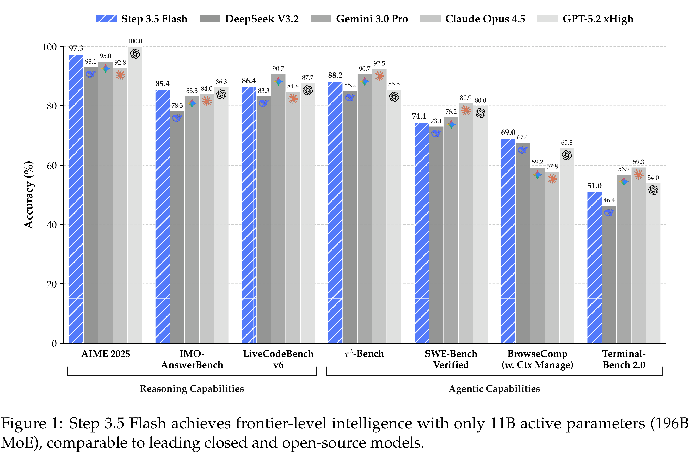

# Step 3.5 Flash: Open Frontier-Level Intelligence with 11B Active Parameters

[Official source](https://github.com/stepfun-ai/Step-3.5-Flash)

## Abstract

We introduce Step 3.5 Flash, a sparse Mixture-of-Experts (MoE) model that bridges the gap between frontier-level agentic intelligence and computational efficiency. We focus on what matters most when building agents: reasoning that’s sharp, and execution that’s fast and reliable. Reflecting these priorities, Step 3.5 Flash pairs a 196B-parameter foundation for high-fidelity modeling with 11B active parameters for efficient inference, optimized by interleaved 3:1 Sliding Window/Full Attention and Multi-Token Prediction (MTP-3) to minimize the latency and cost of multi-round agentic interactions. Toward frontier-level intelligence, we design a scalable RL framework that integrates verifiable signals and preference feedback while maintaining stability during large-scale off-policy training to drive consistent self-improvement across mathematics, code, and tool use. Step 3.5 Flash demonstrates strong intelligence across agent, coding, and math tasks, achieving 85.4% on IMO-AnswerBench and 86.4% on LiveCodeBench-v6 (2024.08–2025.05), 88.2% on 𝜏2-Bench, 69.0% on BrowseComp (w. Context Manage), and 51.0% on Terminal-Bench 2.0 —performance on par with frontier models such as GPT-5.2 xHigh and Gemini 3.0 Pro. By redefining the efficiency frontier, Step 3.5 Flash provides a high-density foundation for deploying sophisticated agents in real-world industrial environments.

Figure 1: Step 3.5 Flash achieves frontier-level intelligence with only 11B active parameters (196B MoE), comparable to leading closed and open-source models.

p. 1
