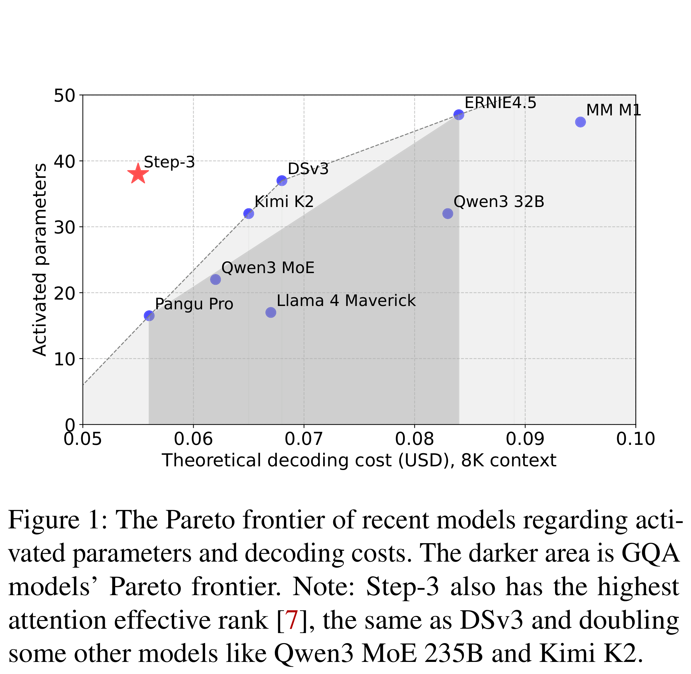

# Step-3 is Large yet Affordable: Model-system Co-design for Cost-effective Decoding

[Official source](https://github.com/stepfun-ai/Step3)

## Abstract

Large language models (LLMs) face low hardware efficiency during decoding, especially for long-context reasoning tasks. This paper introduces Step-3, a 321B-parameter VLM with hardware-aware model-system co-design optimized for minimizing decoding costs. Step-3 innovates in two key dimensions: (1) A novel Multi-Matrix Factorization Attention (MFA) mechanism that significantly reduces both KV cache size and computation while maintaining high attention expressiveness, and (2) Attention-FFN Disaggregation (AFD), a distributed inference system that decouples attention and Feed-Forward Network (FFN) layers into specialized subsystems. This co-design achieves unprecedented cost efficiency: Step-3 significantly reduces theoretical decoding costs compared with models like DeepSeek-V3 and Qwen3 MoE 235B, with the gains widening at longer context. Step-3 achieves low cost while activating 38B parameters per token (more than DeepSeek-V3 and Qwen3 MoE 235B), demonstrating that hardware-aligned attention arithmetic intensity, MoE sparsity, and AFD are critical to cost-effectiveness. We perform a head-to-head comparison with DeepSeek-V3 in its favorable scenarios. Our implementation on Hopper GPUs achieves a decoding throughput of up to 4,039 tokens per second per GPU under 50ms TPOT SLA (4K context, FP8, no MTP). It is higher than DeepSeek-V3’s 2,324 in the same setup and sets a new Pareto frontier for LLM decoding.

Figure 1: The Pareto frontier of recent models regarding activated parameters and decoding costs. The darker area is GQA models’ Pareto frontier. Note: Step-3 also has the highest attention effective rank [7], the same as DSv3 and doubling some other models like Qwen3 MoE 235B and Kimi K2.

p. 1
