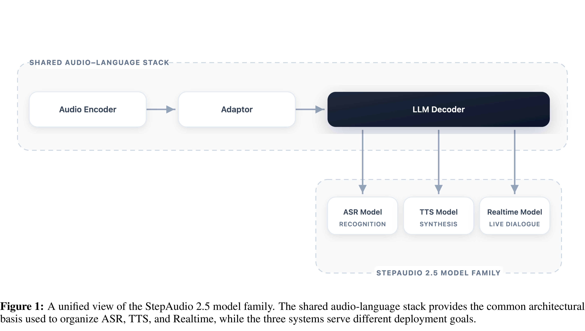

# StepAudio 2.5 Technical Report

[Official source](https://arxiv.org/abs/2605.23463)

## Abstract

Unified audio-language modeling has emerged as a prominent trend in modern speech systems, promising to bring the reasoning capabilities of large language models to auditory tasks. However, existing unified foundations often struggle to match the depth of specialized systems across automatic speech recognition (ASR), text-to-speech synthesis (TTS), and realtime spoken interaction. Bridging this gap remains an open challenge. This report presents StepAudio 2.5, a unified audio-language foundation model that matches or exceeds specialized systems across all three capabilities. Rather than treating these tasks as architecturally distinct, we operate on the premise that once text and audio share a multimodal representational space, task specialization becomes a matter of operational regimes: data construction, optimization targets, and decoding constraints. Guided by this insight, we advance the post-training paradigm from standard supervised learning to task-tailored Reinforcement Learning from Human Feedback (RLHF), using it as the primary mechanism to define complex optimization targets. We leverage this RLHF-centric alignment, alongside specialized decoding, to shape a shared backbone into three distinct operational modes. Concretely, the ASR branch advances transcription efficiency via verifiable multi-token decoding; the TTS branch achieves controllable, expressive synthesis through preference-based RLHF and context-rich supervision; and the Realtime branch realizes low-latency, persona-consistent dialogue via generative reward modeling within an RLHF framework. On standard benchmarks, StepAudio 2.5 achieves state-of-the-art results across ASR, TTS, and Realtime, demonstrating that a singular audio-language foundation can successfully internalize the distinct deployment objectives of speech understanding, generation, and live interaction.

Figure 1: A unified view of the StepAudio 2.5 model family. The shared audio-language stack provides the common architectural basis used to organize ASR, TTS, and Realtime, while the three systems serve different deployment goals.

p. 4
