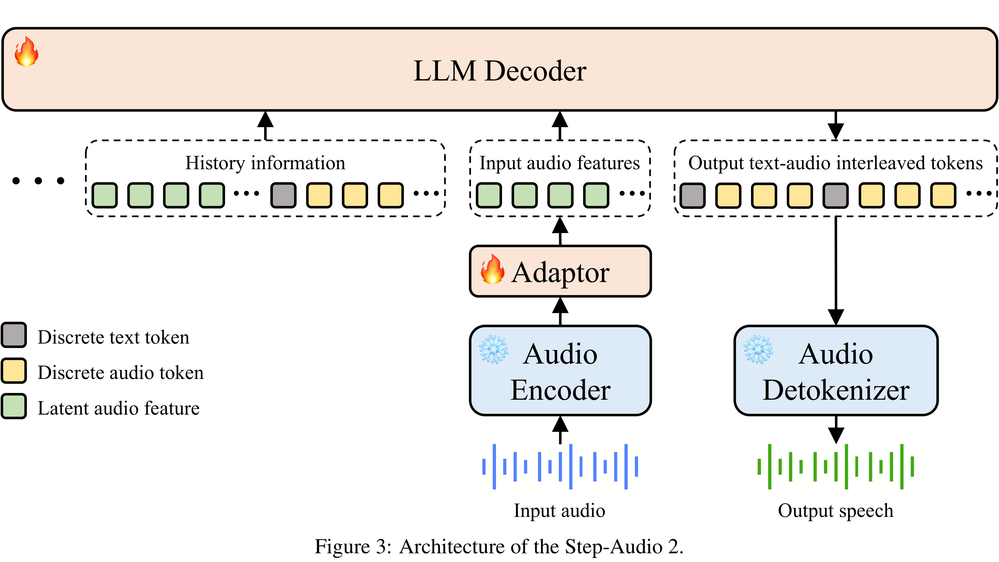

# Step-Audio 2 Technical Report

[Official source](https://github.com/stepfun-ai/Step-Audio2)

## Abstract

This paper presents Step-Audio 2, an end-to-end multi-modal large language model designed for industry-strength audio understanding and speech conversation. By integrating a latent audio encoder and reasoning-centric reinforcement learning (RL), Step-Audio 2 achieves promising performance in automatic speech recognition (ASR) and audio understanding. To facilitate genuine end-to-end speech conversation, Step-Audio 2 incorporates the generation of discrete audio tokens into language modeling, significantly enhancing its responsiveness to paralinguistic information such as speaking styles and emotions. To effectively leverage the rich textual and acoustic knowledge in real-world data, Step-Audio 2 integrates retrieval-augmented generation (RAG) and is able to call external tools such as web search to mitigate hallucination and audio search to switch timbres. Trained on millions of hours of speech and audio data, Step-Audio 2 delivers intelligence and expressiveness across diverse conversational scenarios. Evaluation results demonstrate that Step-Audio 2 achieves state-of-the-art performance on various audio understanding and conversational benchmarks compared to other open-source and commercial solutions. Please visit https://github.com/stepfun-ai/Step-Audio2 for more information.

Figure 3: Architecture of the Step-Audio 2.

p. 6
