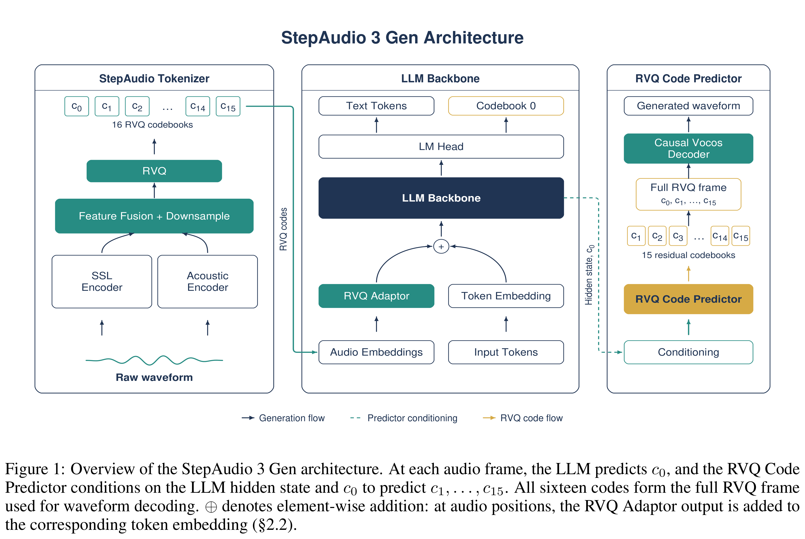
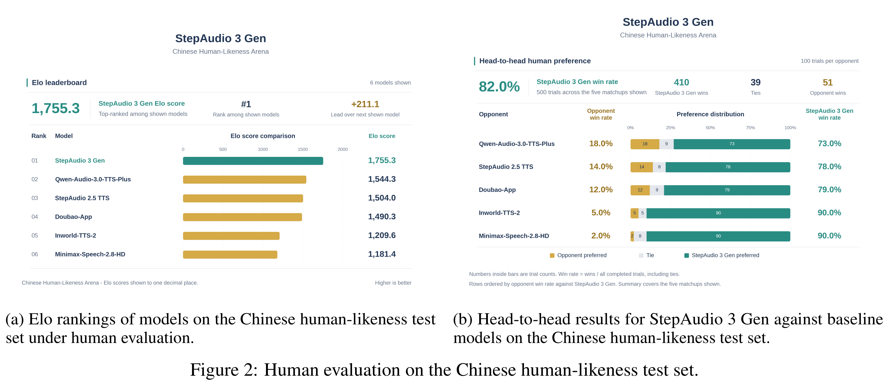

# StepAudio 3 Gen Technical Report

Models: StepAudio 3 TTS

[Source summaries](../README.md) · [中文索引](../README_CN.md)

[Original PDF](../../pdfs/stepfun/technical-reports/step-audio-3-gen--arxiv-v1.pdf#page=1) · [Official source](https://arxiv.org/abs/2609.12945)

PDF pages: 1 · Source text cross-checked with two extractors; not manually verified.

## Abstract

We introduce StepAudio 3 Gen, a general-purpose audio generation model that supports zero-shot text-to-speech (TTS), voice design, vocal generation, sound ef- fects, music, vibe speech, and mixtures of multiple audio types within a unified framework. At its core, StepAudio 3 Gen is a discrete autoregressive generator that models audio directly over residual vector quantization (RVQ) tokens, departing from the diffusion Transformer-based continuous generation paradigm prevalent in recent general audio models. Its StepAudio Tokenizer represents general audio at 12.5 Hz in a shared 16 × 2048 residual code space, jointly quantizing semantic and waveform-level acoustic features so that each code layer preserves both types of information. For generation, the backbone predicts the first codebook along the time axis using autoregressive modeling, while a lightweight causal Transformer completes the remaining fifteen codebooks along the codebook axis. Our study further identifies three key design principles: (1) interference-aware progressive pretraining for acquiring audio capabilities while preserving the textual abilities of the large language model, (2) RVQ Adaptor for effectively incorporating multi- codebook acoustic representations, and (3) discrete autoregressive modeling over a shared representation across general audio domains. With progressive pretraining, multi-task instruction training, and supervised fine-tuning, StepAudio 3 Gen achieves state-of-the-art performance on both TTS and voice design, while retaining strong generation capabilities across speech, vocals, sound effects, and music. Audio sam- ples are available at https://stepaudiollm.github.io/step-audio-3-gen/.

## Core figures

[All figures and original captions](../../figures/stepfun/step-audio-3-gen/README.md) · [中文](../../figures/stepfun/step-audio-3-gen/README_CN.md)

### Architecture · Figure 1

Source page: 4 · [Original graphics PDF](../../figures/stepfun/step-audio-3-gen/figure-01.pdf) · [High-resolution PNG](../../figures/stepfun/step-audio-3-gen/figure-01.png)

Figure 1: Overview of the StepAudio 3 Gen architecture. At each audio frame, the LLM predicts c0, and the RVQ Code
Predictor conditions on the LLM hidden state and c0 to predict c1, . . . , c15. All sixteen codes form the full RVQ frame
used for waveform decoding. ⊕denotes element-wise addition: at audio positions, the RVQ Adaptor output is added to
the corresponding token embedding (§2.2).

### Results · Figure 2

Source page: 12 · [Original graphics PDF](../../figures/stepfun/step-audio-3-gen/figure-02.pdf) · [High-resolution PNG](../../figures/stepfun/step-audio-3-gen/figure-02.png)

Figure 2: Human evaluation on the Chinese human-likeness test set.
