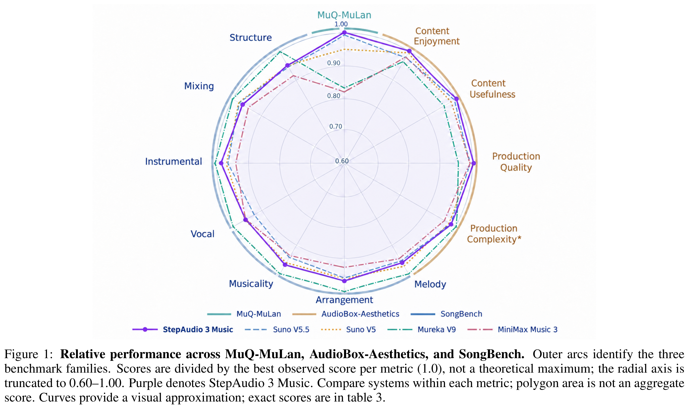
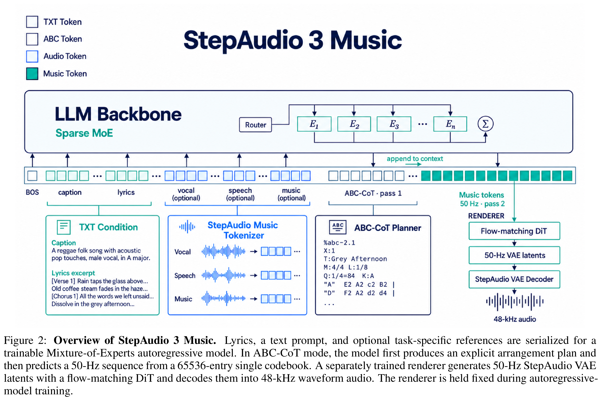

# StepAudio 3 Music Technical Report

[Official source](https://arxiv.org/abs/2609.16034)

## Abstract

We introduce StepAudio 3 Music, a large-scale, long-form music generation model that supports explicit musical plan- ning and open-domain text-controlled generation. The StepAudio Music Tokenizer represents audio as a 50-Hz stream from a 65536-entry single codebook, using semantically informed self-supervised and multi-task training to preserve musical structure and reconstruction-relevant information. A flow-matching diffusion Transformer (DiT) predicts con- tinuous StepAudio VAE latents, which our VAE decoder converts into 48-kHz audio. This discrete–continuous design is guided by comparisons of single-codebook VQ, Semantic and Acoustic RVQ, and different DiT configurations. For explicit planning, a Mixture-of-Experts autoregressive model uses ABC notation to produce an intermediate arrange- ment plan (ABC-CoT) before predicting music tokens, making harmony, rhythm, and melodic structure part of the generation context. A progressive training curriculum and supervised fine-tuning support song and instrumental gener- ation, accompaniment generation from dry vocals, and cover-song synthesis for up to 5 minutes and 30 seconds. With reinforcement learning via direct preference optimization (DPO), the final model achieves the highest AudioBox Con- tent Enjoyment, Content Usefulness, and Production Quality scores and the highest MuQ-MuLan similarity among the evaluated systems, with competitive SongBench results. On the preliminary Artificial Analysis Music Arena Vocals leaderboard, it obtains a Quality Elo of 1105, behind only Suno V5.5 and Mureka and ahead of Suno V5, MiniMax models, and other systems. Audio demonstrations are available at https://stepaudiollm.github.io/step-audio-3-music.

Figure 1: Relative performance across MuQ-MuLan, AudioBox-Aesthetics, and SongBench. Outer arcs identify the three
benchmark families. Scores are divided by the best observed score per metric (1.0), not a theoretical maximum; the radial axis is
truncated to 0.60–1.00. Purple denotes StepAudio 3 Music. Compare systems within each metric; polygon area is not an aggregate
score. Curves provide a visual approximation; exact scores are in table 3.

p. 1

Figure 2: Overview of StepAudio 3 Music. Lyrics, a text prompt, and optional task-specific references are serialized for a
trainable Mixture-of-Experts autoregressive model. In ABC-CoT mode, the model first produces an explicit arrangement plan and
then predicts a 50-Hz sequence from a 65536-entry single codebook. A separately trained renderer generates 50-Hz StepAudio VAE
latents with a flow-matching DiT and decodes them into 48-kHz waveform audio. The renderer is held fixed during autoregressive-
model training.

p. 4
