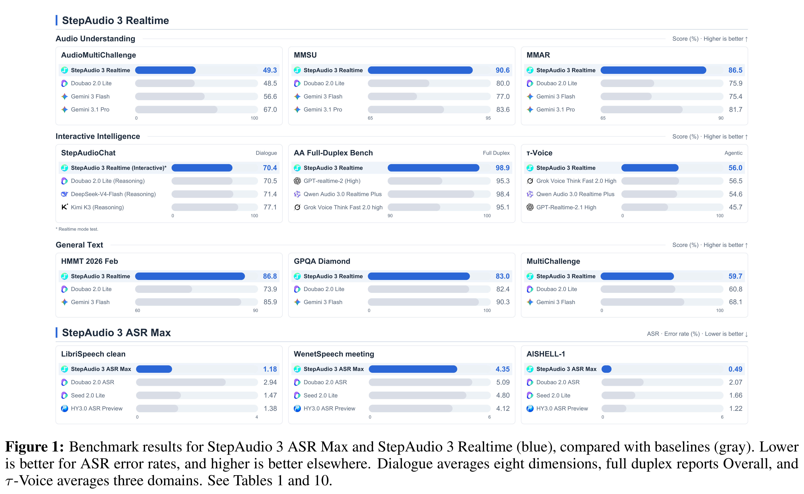
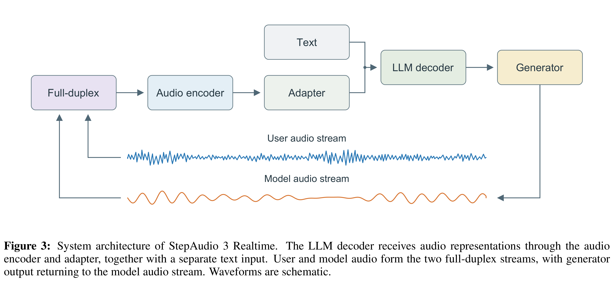

# StepAudio 3 Realtime Technical Report

Models: StepAudio 3 Realtime

[Source summaries](../README.md) · [中文索引](../README_CN.md)

[Original PDF](../../pdfs/stepfun/technical-reports/step-audio-3-realtime--arxiv-v2.pdf#page=1) · [Official source](https://arxiv.org/abs/2609.14005)

PDF pages: 1 · Source text cross-checked with two extractors; not manually verified.

## Abstract

Realtime spoken interaction demands deep reasoning, prompt responses, and fluid turn-taking. We present StepAudio 3 Realtime, an audio-language foundation model organized around a continuous listen-converse-think-act loop. Deep Percep- tion captures rich acoustic cues to interpret user intent, while Seamless Duplex mod- els synchronized audio streams to handle pauses, backchannels, and interruptions naturally. Crucially, we resolve the tension between deep deliberation and latency via Think-While-Speaking, executing private reasoning in parallel with spoken de- livery. In reasoning mode, StepAudio 3 reaches a 73.0 macro average on StepAu- dioChat. With Think-While-Speaking, it achieves dialogue and reasoning perfor- mance comparable to dedicated reasoning models while speaking in real time. Fur- thermore, an integrated Voice Agent handles asynchronous tool execution without disrupting the dialogue flow. StepAudio 3 Realtime achieves top-tier performance across key dimensions: an exceptional 90.6 on the MMSU benchmark, 98.9 Overall on the Artificial Analysis Full-Duplex Bench, and a 56.0% macro task-success rate on τ -Voice.

## Core figures

[All figures and original captions](../../figures/stepfun/step-audio-3-realtime/README.md) · [中文](../../figures/stepfun/step-audio-3-realtime/README_CN.md)

### Results · Figure 1

Source page: 1 · [Original graphics PDF](../../figures/stepfun/step-audio-3-realtime/figure-01.pdf) · [High-resolution PNG](../../figures/stepfun/step-audio-3-realtime/figure-01.png)

Figure 1: Benchmark results for StepAudio 3 ASR Max and StepAudio 3 Realtime (blue), compared with baselines (gray). Lower
is better for ASR error rates, and higher is better elsewhere. Dialogue averages eight dimensions, full duplex reports Overall, and
τ-Voice averages three domains. See Tables 1 and 10.

### Architecture · Figure 3

Source page: 4 · [Original graphics PDF](../../figures/stepfun/step-audio-3-realtime/figure-02.pdf) · [High-resolution PNG](../../figures/stepfun/step-audio-3-realtime/figure-02.png)

Figure 3: System architecture of StepAudio 3 Realtime. The LLM decoder receives audio representations through the audio
encoder and adapter, together with a separate text input. User and model audio form the two full-duplex streams, with generator
output returning to the model audio stream. Waveforms are schematic.
