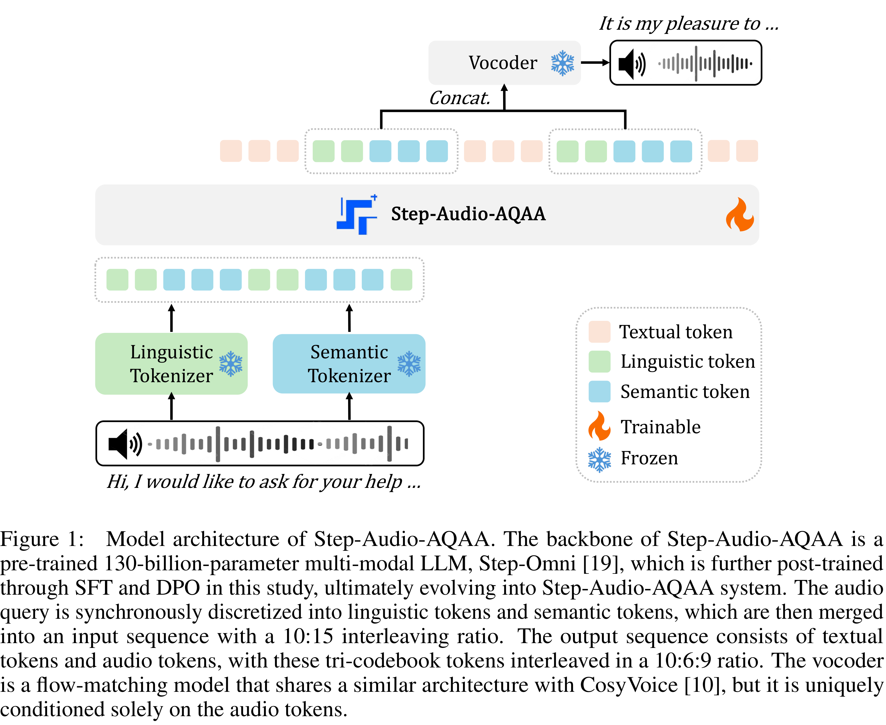

# Step-Audio-AQAA: a Fully End-to-End Expressive Large Audio Language Model

[Official source](https://github.com/stepfun-ai/Step-Audio)

## Abstract

Large Audio-Language Models (LALMs) have significantly advanced intelligent human-computer interaction, yet their reliance on text-based outputs limits their ability to generate natural speech responses directly, hindering seamless audio interactions. To address this, we introduce Step-Audio-AQAA, a fully end-to-end LALM designed for Audio Query-Audio Answer (AQAA) tasks. The model integrates a dual-codebook audio tokenizer for linguistic and semantic feature extraction, a 130-billion-parameter backbone LLM and a neural vocoder for high-fidelity speech synthesis. Our post-training approach employs interleaved token-output of text and audio to enhance semantic coherence and combines Direct Preference Optimization (DPO) with model merge to improve performance. Evaluations on the StepEval-Audio-360 benchmark demonstrate that Step-Audio-AQAA excels especially in speech control, outperforming the state-of-art LALMs in key areas. This work contributes a promising solution for end-to-end LALMs and highlights the critical role of token-based vocoder in enhancing overall performance for AQAA tasks. The model and demo have been released 1.

Figure 1: Model architecture of Step-Audio-AQAA. The backbone of Step-Audio-AQAA is a pre-trained 130-billion-parameter multi-modal LLM, Step-Omni [19], which is further post-trained through SFT and DPO in this study, ultimately evolving into Step-Audio-AQAA system. The audio query is synchronously discretized into linguistic tokens and semantic tokens, which are then merged into an input sequence with a 10:15 interleaving ratio. The output sequence consists of textual tokens and audio tokens, with these tri-codebook tokens interleaved in a 10:6:9 ratio. The vocoder is a flow-matching model that shares a similar architecture with CosyVoice [10], but it is uniquely conditioned solely on the audio tokens.

p. 3
