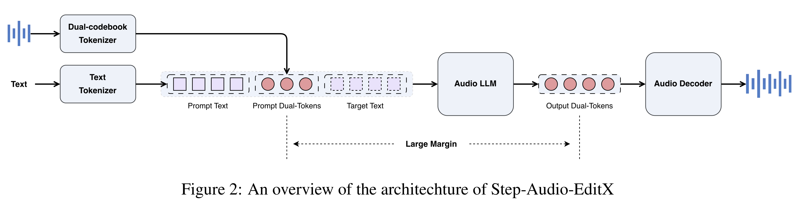

# Step-Audio-EditX Technical Report

[Official source](https://github.com/stepfun-ai/Step-Audio-EditX)

## Abstract

We present Step-Audio-EditX, the first open-source LLM-based reinforcement learning audio model excelling at expressive and iterative audio editing—encompassing emotion, speaking style, and paralinguistics—alongside robust zero-shot text-to-speech (TTS) capabilities. Our core innovation lies in leveraging only large-margin synthetic data in post-training, which circumvents the need for embedding-based priors or auxiliary modules. This large-margin learning approach enables both iterative control and high expressivity across voices, and represents a fundamental pivot from the conventional focus on representation-level disentanglement. Evaluation results demonstrate that Step-Audio-EditX surpasses both MiniMax-2.6-hd and Doubao-Seed-TTS-2.0 in emotion editing and other fine-grained control tasks. Our code and models are available at https://github.com/stepfun-ai/Step-Audio-EditX.

Figure 2: An overview of the architechture of Step-Audio-EditX

p. 3
