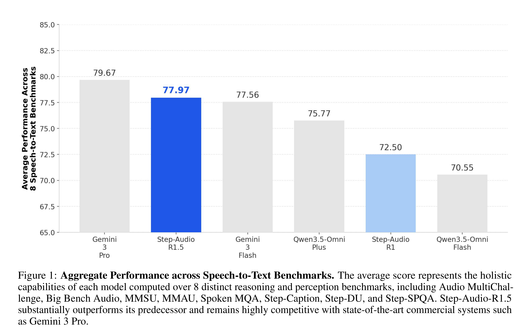

# Step-Audio-R1.5 Technical Report

[Official source](https://github.com/stepfun-ai/Step-Audio-R1)

## Abstract

Recent advancements in large audio language models have extended Chain-of-Thought (CoT) reasoning into the auditory domain, enabling models to tackle increasingly complex acoustic and spoken tasks. To elicit and sustain these extended reasoning chains, the prevailing paradigm—driven by the success of text-based reasoning models—overwhelmingly relies on Reinforcement Learning with Verified Rewards (RLVR). However, as models are strictly optimized to distill rich, continuous auditory contexts into isolated, verifiable text labels, a fundamental question arises: are we fostering true audio intelligence, or merely reducing a continuous sensory medium into a discrete puzzle? We identify this as the "verifiable reward trap." While RLVR yields remarkable scores on standardized objective benchmarks, it systematically degrades the real-world conversational feel of audio models. By prioritizing isolated correctness over acoustic nuance, RLVR reduces dynamic interactions to mechanical "answering machines," severely compromising prosodic naturalness, emotional continuity, and user immersion, particularly in long-turn dialogues. To bridge the gap between mechanical objective verification and genuine sensory empathy, we introduce Step-Audio-R1.5. Marking a paradigm shift toward Reinforcement Learning from Human Feedback (RLHF) in audio reasoning. Comprehensive evaluations demonstrate that Step-Audio-R1.5 not only maintains robust analytical reasoning but profoundly transforms the interactive experience, redefining the boundaries of deeply immersive long-turn spoken dialogue.

Figure 1: Aggregate Performance across Speech-to-Text Benchmarks. The average score represents the holistic capabilities of each model computed over 8 distinct reasoning and perception benchmarks, including Audio MultiChallenge, Big Bench Audio, MMSU, MMAU, Spoken MQA, Step-Caption, Step-DU, and Step-SPQA. Step-Audio-R1.5 substantially outperforms its predecessor and remains highly competitive with state-of-the-art commercial systems such as Gemini 3 Pro.

p. 2
