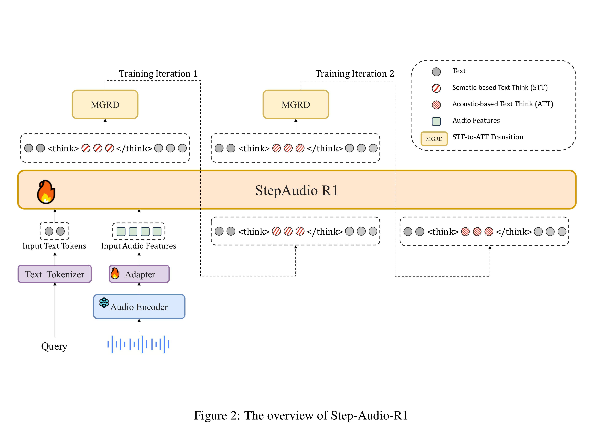

# Step-Audio-R1 Technical Report

[Official source](https://github.com/stepfun-ai/Step-Audio-R1)

## Abstract

Recent advances in reasoning models have demonstrated remarkable success in text and vision domains through extended chain-of-thought deliberation. However, a perplexing phenomenon persists in audio language models: they consistently perform better with minimal or no reasoning, raising a fundamental question—can audio intelligence truly benefit from deliberate thinking? We introduce Step-Audio-R1, the first audio reasoning model that successfully unlocks reasoning capabilities in the audio domain. Through our proposed Modality-Grounded Reasoning Distillation (MGRD) framework, Step-Audio-R1 learns to generate audio-relevant reasoning chains that genuinely ground themselves in acoustic features rather than hallucinating disconnected deliberations. Our model exhibits strong audio reasoning capabilities, surpassing Gemini 2.5 Pro and achieving performance comparable to the state-of-the-art Gemini 3 Pro across comprehensive audio understanding and reasoning benchmarks spanning speech, environmental sounds, and music. These results demonstrate that reasoning is a transferable capability across modalities when appropriately anchored, transforming extended deliberation from a liability into a powerful asset for audio intelligence. By establishing the first successful audio reasoning model, Step-Audio-R1 opens new pathways toward building truly multimodal reasoning systems that think deeply across all sensory modalities.

Figure 2: The overview of Step-Audio-R1

p. 3
