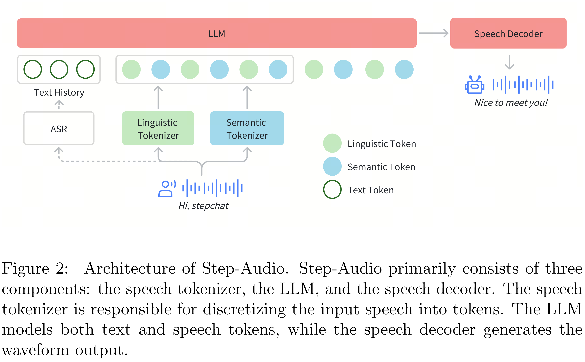

# Step-Audio: Unified Understanding and Generation in Intelligent Speech Interaction

[Official source](https://github.com/stepfun-ai/Step-Audio)

## Abstract

Real-time speech interaction, serving as a fundamental interface for human-machine collaboration, holds immense potential. However, current open-source models face limitations such as high costs in voice data collection, weakness in dynamic control, and limited intelligence. To address these challenges, this paper introduces Step-Audio, the first production-ready open-source solution. Key contributions include: 1) a 130B-parameter unified speech-text multi-modal model that achieves unified understanding and generation, with the Step-Audio-Chat version open-sourced; 2) a generative speech data engine that establishes an affordable voice cloning framework and produces the open-sourced lightweight Step-Audio-TTS-3B model through distillation; 3) an instruction-driven fine control system enabling dynamic adjustments across dialects, emotions, singing, and RAP; 4) an enhanced cognitive architecture augmented with tool calling and role-playing abilities to manage complex tasks effectively. Based on our new StepEval-Audio-360 evaluation benchmark, Step-Audio achieves state-of-the-art performance in human evaluations, especially in terms of instruction following. On open-source benchmarks like LLaMA Question, shows 9.3% average performance improvement, demonstrating our commitment to advancing the development of open-source multi-modal language technologies. Our code and models are available at https://github.com/stepfun-ai/Step-Audio.

Figure 2: Architecture of Step-Audio. Step-Audio primarily consists of three components: the speech tokenizer, the LLM, and the speech decoder. The speech tokenizer is responsible for discretizing the input speech into tokens. The LLM models both text and speech tokens, while the speech decoder generates the waveform output.

p. 5
