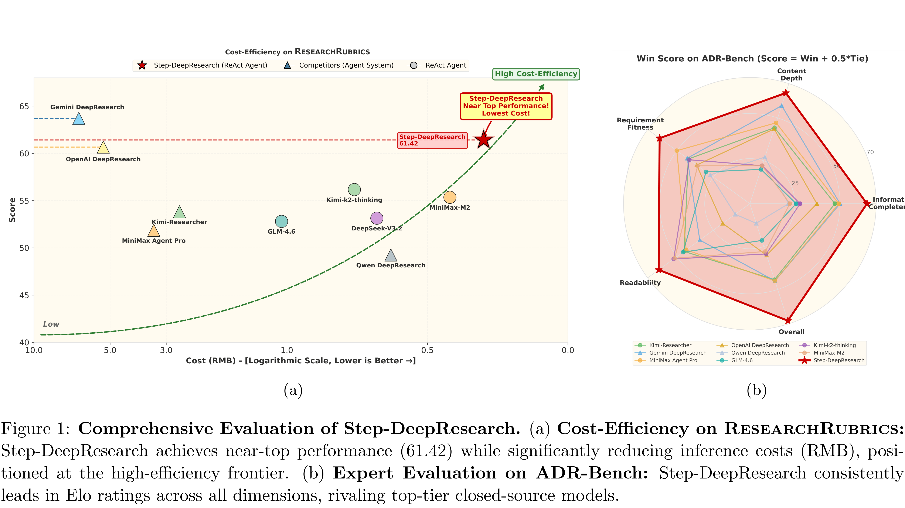

# Step-DeepResearch Technical Report

[Official source](https://github.com/stepfun-ai/StepDeepResearch)

## Abstract

As Large Language Models (LLMs) shift toward autonomous agents, Deep Research has emerged as a pivotal metric for assessing the core competitiveness of agents. However, existing works primarily focus on academic multi-hop search tasks with ground truth, such as BrowseComp, which often struggle to satisfy user demands for open-ended research tasks in real-world scenarios. Open-ended research not only demands robust retrieval capabilities but also challenges the agent’s comprehensive skills in latent intent recognition, long-horizon decision-making, multi-turn tool use, logical structuring, and cross-source verification. To address this, we introduce Step-DeepResearch, a cost-effective, end-to-end Deep Research agent model. We propose a novel Data Synthesis Strategy Based on Atomic Capabilities, aimed at reinforcing underlying capabilities in planning, information seeking, reflection, and report writing. In terms of the training paradigm, we construct a progressive path from agentic mid-training to supervised fine-tuning and reinforcement learning. Combined with a Checklist-style Judger reward design, this approach significantly improves robustness across diverse scenarios. Furthermore, to address the lack of evaluations reflecting real-world demands in the Chinese domain, we establish ADR-Bench, a Chinese benchmark for realistic Deep Research scenarios. Experimental results demonstrate that Step-DeepResearch, with only 32B parameters, achieves a high score of 61.42 on the Scale AI ResearchRubrics. In expert human evaluations on ADR-Bench, its Elo score significantly outperforms comparable models and rivals state-of-the-art proprietary services such as OpenAI DeepResearch and Gemini DeepResearch. These findings prove that through a refined training scheme, medium-sized models can achieve expert-level Deep Research capabilities. With extremely low deployment and inference costs, Step-DeepResearch stands as the most cost-effective Deep Research agent model currently available in the industry.

(a)

(b)

Figure 1: Comprehensive Evaluation of Step-DeepResearch. (a) Cost-Efficiency on ResearchRubrics: Step-DeepResearch achieves near-top performance (61.42) while significantly reducing inference costs (RMB), positioned at the high-efficiency frontier. (b) Expert Evaluation on ADR-Bench: Step-DeepResearch consistently leads in Elo ratings across all dimensions, rivaling top-tier closed-source models.

p. 1
