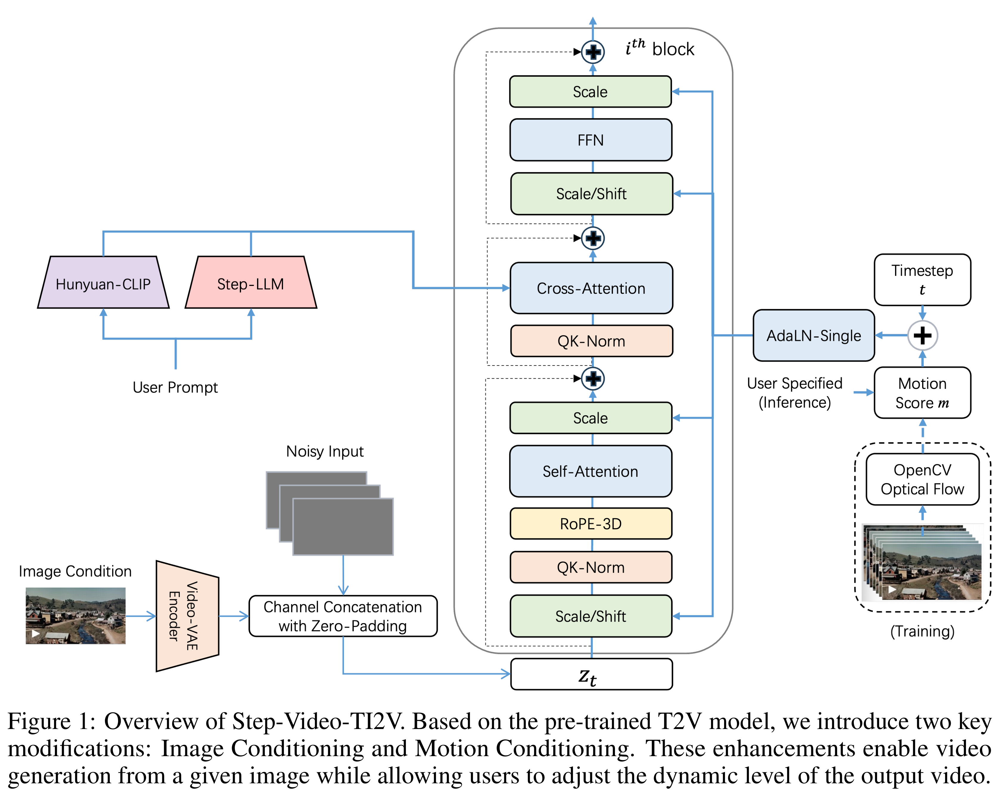

# Step-Video-TI2V Technical Report: A State-of-the-Art Text-Driven Image-to-Video Generation Model

[Official source](https://github.com/stepfun-ai/Step-Video-TI2V)

## Abstract

We present Step-Video-TI2V, a state-of-the-art text-driven image-to-video generation model with 30B parameters, capable of generating videos up to 102 frames based on both text and image inputs. We build Step-Video-TI2V-Eval as a new benchmark for the text-driven image-to-video task and compare Step-Video-TI2V with open-source and commercial TI2V engines using this dataset. Experimental results demonstrate the state-of-the-art performance of Step-Video-TI2V in the image-to-video generation task. Both Step-Video-TI2V and Step-Video-TI2V-Eval are available at https://github.com/stepfun-ai/Step-Video-TI2V.

Figure 1: Overview of Step-Video-TI2V. Based on the pre-trained T2V model, we introduce two key modifications: Image Conditioning and Motion Conditioning. These enhancements enable video generation from a given image while allowing users to adjust the dynamic level of the output video.

p. 2
