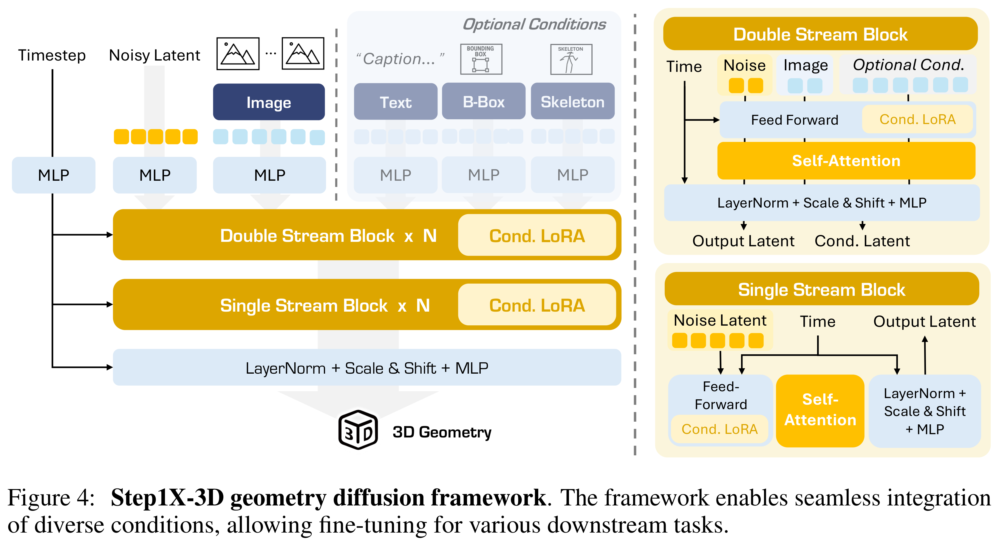
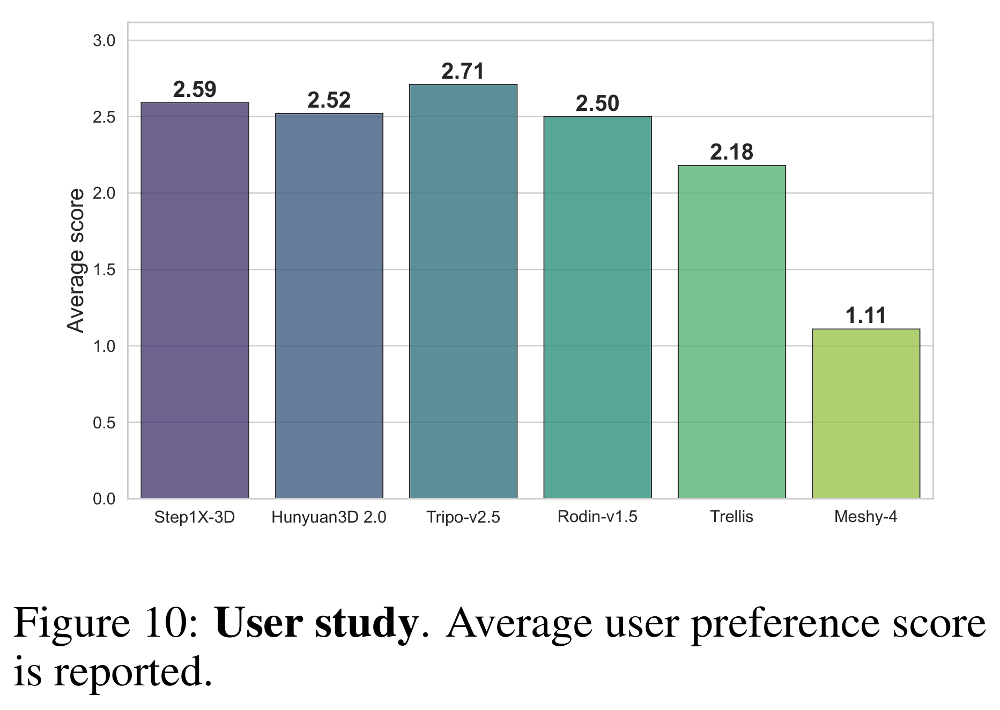

# Step1X-3D: Towards High-Fidelity and Controllable Generation of Textured 3D Assets

[Official source](https://github.com/stepfun-ai/Step1X-3D)

## Abstract

While generative artificial intelligence has advanced significantly across text, image, audio, and video domains, 3D generation remains comparatively underdeveloped due to fundamental challenges such as data scarcity, algorithmic limitations, and ecosystem fragmentation. To this end, we present Step1X-3D, an open framework addressing these challenges through: (1) a rigorous data curation pipeline processing >5M assets to create a 2M high-quality dataset with standardized geometric and textural properties; (2) a two-stage 3D-native architecture combining a hybrid VAE-DiT geometry generator with an diffusion-based texture synthesis module; and (3) the full open-source release of models, training code, and adaptation modules. For geometry generation, the hybrid VAE-DiT component produces TSDF representations by employing perceiver-based latent encoding with sharp edge sampling for detail preservation. The diffusion-based texture synthesis module then ensures cross-view consistency through geometric conditioning and latent-space synchronization. Benchmark results demonstrate state-of-the-art performance that exceeds existing open-source methods, while also achieving competitive quality with proprietary solutions. Notably, the framework uniquely bridges the 2D and 3D generation paradigms by supporting direct transfer of 2D control techniques (e.g., LoRA) to 3D synthesis. By simultaneously advancing data quality, algorithmic fidelity, and reproducibility, Step1X-3D aims to establish new standards for open research in controllable 3D asset generation.

Figure 4: Step1X-3D geometry diffusion framework. The framework enables seamless integration of diverse conditions, allowing fine-tuning for various downstream tasks.

p. 8

Figure 10: User study. Average user preference score is reported.

p. 16
