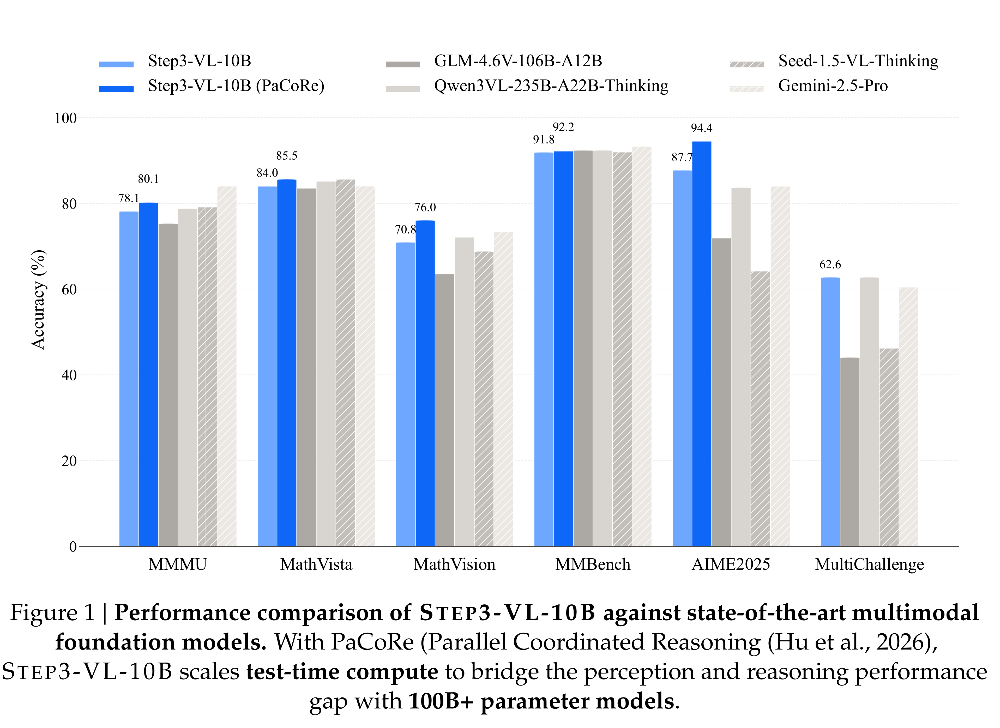

# STEP3-VL-10B Technical Report

[Official source](https://github.com/stepfun-ai/Step3-VL-10B)

## Abstract

We present STEP3-VL-10B, a lightweight open-source foundation model designed to redefine the trade-off between compact efficiency and frontier-level multimodal intelligence. STEP3-VL-10B is realized through two strategic shifts: first, a unified, fully unfrozen pre-training strategy on 1.2T multimodal tokens that integrates a language-aligned Perception Encoder with a Qwen3-8B decoder to establish intrinsic vision-language synergy; and second, a scaled post-training pipeline featuring over 1k iterations of reinforcement learning. Crucially, we implement Parallel Coordinated Reasoning (PaCoRe) to scale test-time compute, allocating resources to scalable perceptual reasoning that explores and synthesizes diverse visual hypotheses. Consequently, despite its compact 10B footprint, STEP3-VL-10B rivals or surpasses models 10×–20× larger (e.g., GLM-4.6V-106B, Qwen3-VL-235B) and top-tier proprietary flagships like Gemini 2.5 Pro and Seed-1.5-VL. Delivering best-in-class performance, it records 92.2% on MM-Bench and 80.11% on MMMU, while excelling in complex reasoning with 94.43% on AIME2025 and 75.95% on MathVision. We release the full model suite to provide the community with a powerful, efficient baseline.

Figure 1 | Performance comparison of STEP3-VL-10B against state-of-the-art multimodal foundation models. With PaCoRe (Parallel Coordinated Reasoning (Hu et al., 2026), STEP3-VL-10B scales test-time compute to bridge the perception and reasoning performance gap with 100B+ parameter models.

p. 1
