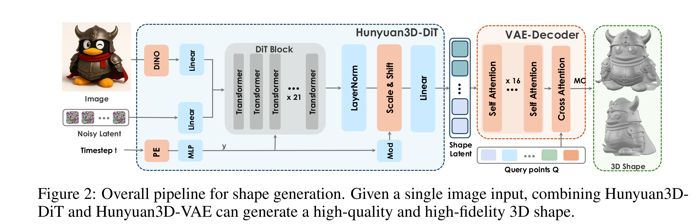

# Hunyuan3D 2.1: From Images to High-Fidelity 3D Assets with Production-Ready PBR Material

[Official source](https://github.com/Tencent-Hunyuan/Hunyuan3D-2.1)

## Abstract

3D AI-generated content (AIGC) is a passionate field that has significantly accelerated the creation of 3D models in gaming, film, and design. Despite the development of several groundbreaking models that have revolutionized 3D generation, the field remains largely accessible only to researchers, developers, and designers due to the complexities involved in collecting, processing, and training 3D models. To address these challenges, we introduce Hunyuan3D 2.1 as a case study in this tutorial. This tutorial offers a comprehensive, step-by-step guide on processing 3D data, training a 3D generative model, and evaluating its performance using Hunyuan3D 2.1, an advanced system for producing high-resolution, textured 3D assets. The system comprises two core components: the Hunyuan3D-DiT for shape generation and the Hunyuan3D-Paint for texture synthesis. We will explore the entire workflow, including data preparation, model architecture, training strategies, evaluation metrics, and deployment. By the conclusion of this tutorial, you will have the knowledge to finetune or develop a robust 3D generative model suitable for applications in gaming, virtual reality, and industrial design.

Figure 2: Overall pipeline for shape generation. Given a single image input, combining Hunyuan3D-DiT and Hunyuan3D-VAE can generate a high-quality and high-fidelity 3D shape.

p. 5
