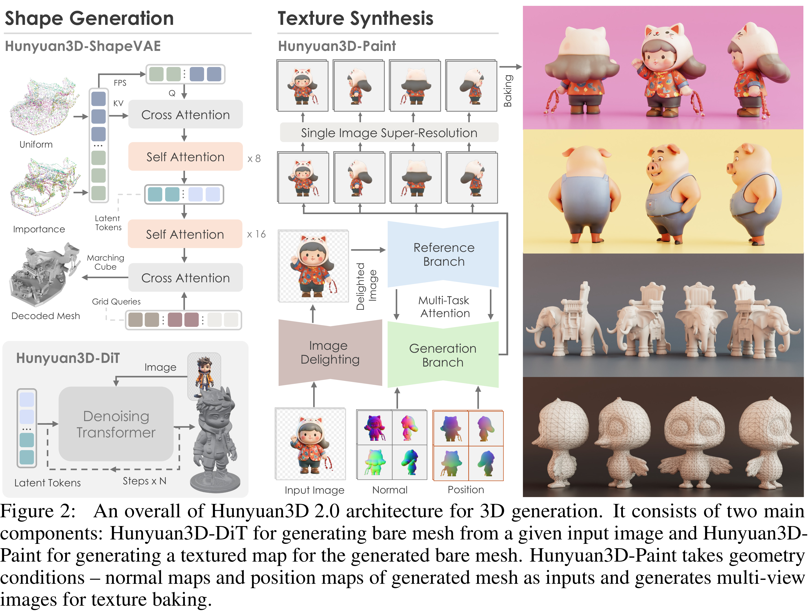

# Hunyuan3D 2.0: Scaling Diffusion Models for High Resolution Textured 3D Assets Generation

[Official source](https://github.com/Tencent-Hunyuan/Hunyuan3D-2)

## Abstract

We present Hunyuan3D 2.0, an advanced large-scale 3D synthesis system for generating high-resolution textured 3D assets. This system includes two foundation components: a large-scale shape generation model – Hunyuan3D-DiT, and a large-scale texture synthesis model – Hunyuan3D-Paint. The shape generative model, built on a scalable flow-based diffusion transformer, aims to create geometry that properly aligns with a given condition image, laying a solid foundation for downstream applications. The texture synthesis model, benefiting from strong geometric and diffusion priors, produces high-resolution and vibrant texture maps for either generated or hand-crafted meshes. Furthermore, we build Hunyuan3D-Studio – a versatile, user-friendly production platform that simplifies the re-creation process of 3D assets. It allows both professional and amateur users to manipulate or even animate their meshes efficiently. We systematically evaluate our models, showing that Hunyuan3D 2.0 outperforms previous state-of-the-art models, including the open-source models and closed-source models in geometry details, condition alignment, texture quality, and etc. Hunyuan3D 2.0 is publicly released in order to fill the gaps in the open-source 3D community for large-scale foundation generative models. The code and pre-trained weights of our models are available at: https://github.com/Tencent/Hunyuan3D-2.

∗ Hunyuan3D team contributors are listed in the end of report.

Figure 2: An overall of Hunyuan3D 2.0 architecture for 3D generation. It consists of two main components: Hunyuan3D-DiT for generating bare mesh from a given input image and Hunyuan3D-Paint for generating a textured map for the generated bare mesh. Hunyuan3D-Paint takes geometry conditions – normal maps and position maps of generated mesh as inputs and generates multi-view images for texture baking.

p. 4
