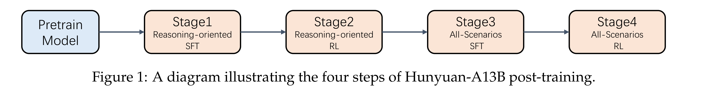

# Hunyuan-A13B Technical Report

[Official source](https://github.com/Tencent-Hunyuan/Hunyuan-A13B)

## Abstract

We present Hunyuan-A13B, an open-source large language model employing a Mixture-of-Experts (MoE) architecture that optimizes the trade-off between computational efficiency and model performance. The architecture leverages 80 billion total parameters while activating only 13 billion parameters during inference, enabling cost-effective deployment without compromising capability. Specifically, Hunyuan-A13B is pretrained on a rigorously filtered 20T token corpus with enhanced STEM-focused data curation, which significantly improves its factual reliability and reasoning abilities. In the post-training stage, Hunyuan-A13B utilizes high-quality data for supervised fine-tuning (SFT) and large-scale reinforcement learning, comprehensively enhancing the model’s performance in all dimensions. To enhance computational efficiency, we implement a dual-mode Chain-of-Thought (CoT) framework that dynamically adjusts reasoning depth based on task requirements. This framework provides a rapid “fast-thinking” mode that handles routine inquiries with low latency, and a deeper “slow-thinking” mode for more involved multi-step reasoning problems. Benchmark evaluations demonstrate that the Hunyuan-A13B achieves competitive performance across diverse domains including mathematical and scientific reasoning, programming, and general language tasks. In mathematical and scientific reasoning tasks, it achieves results comparable to state-of-the-art models with substantially larger parameter counts. The model also approaches the programming competency of these larger counterparts while exhibiting robust agent capabilities in task planning and tool utilization scenarios. Notably, our model exhibits superior inference throughput, making it particularly suitable for latency-sensitive applications. We release Hunyuan-A13B to the open-source community to encourage ongoing advancements in LLMs and to facilitate efficient, research-driven practical applications.

Figure 1: A diagram illustrating the four steps of Hunyuan-A13B post-training.

p. 3
