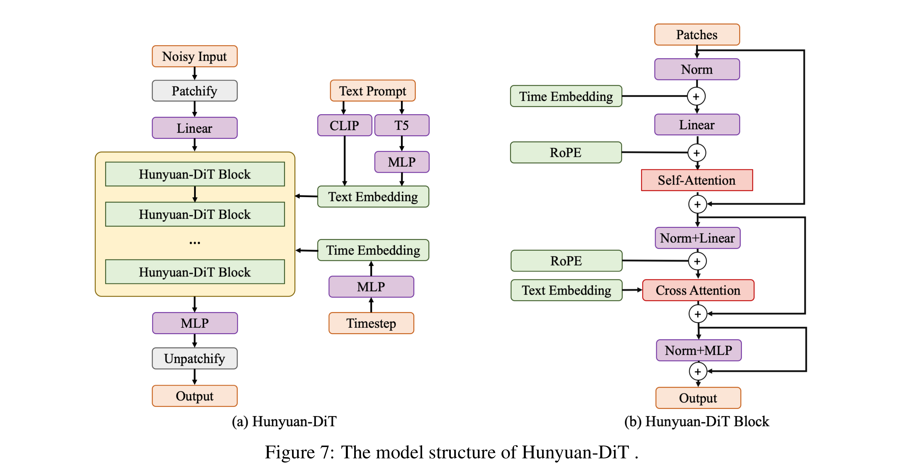

# Hunyuan-DiT: A Powerful Multi-Resolution Diffusion Transformer with Fine-Grained Chinese Understanding

[Official source](https://github.com/Tencent/HunyuanDiT)

## Abstract

We present Hunyuan-DiT, a text-to-image diffusion transformer with fine-grained understanding of both English and Chinese. To construct Hunyuan-DiT, we carefully design the transformer structure, text encoder, and positional encoding. We also build from scratch a whole data pipeline to update and evaluate data for iterative model optimization. For fine-grained language understanding, we train a Multimodal Large Language Model to refine the captions of the images. Finally, Hunyuan-DiT can perform multi-turn multimodal dialogue with users, generating and refining images according to the context. Through our holistic human evaluation protocol with more than 50 professional human evaluators, Hunyuan-DiT sets a new state-of-the-art in Chinese-to-image generation compared with other open-source models. Code and pretrained models are publicly available at github.com/ Tencent/HunyuanDiT

Figure 7: The model structure of Hunyuan-DiT .

p. 8
