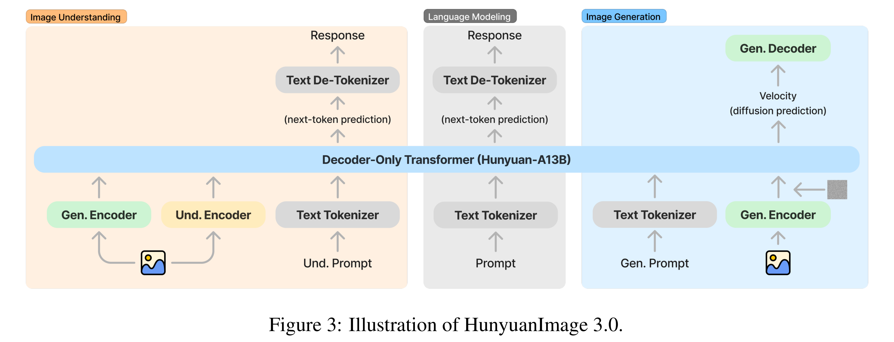
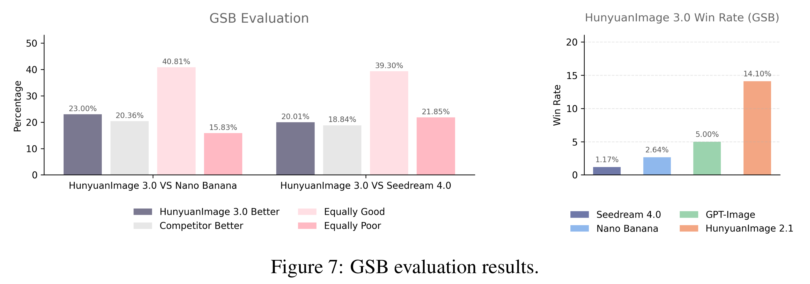

# HunyuanImage 3.0 Technical Report

[Official source](https://github.com/Tencent-Hunyuan/HunyuanImage-3.0)

## Abstract

We present HunyuanImage 3.0, a native multimodal model that unifies multimodal understanding and generation within an autoregressive framework, with its image generation module publicly available. The achievement of HunyuanImage 3.0 relies on several key components, including meticulous data curation, advanced architecture design, a native Chain-of-Thoughts schema, progressive model pre- training, aggressive model post-training, and an efficient infrastructure that enables large-scale training and inference. With these advancements, we successfully trained a Mixture-of-Experts (MoE) model comprising over 80 billion parameters in total, with 13 billion parameters activated per token during inference, making it the largest and most powerful open-source image generative model to date. We conducted extensive experiments and the results of automatic and human evaluation of text-image alignment and visual quality demonstrate that HunyuanImage 3.0 rivals previous state-of-the-art models. By releasing the code and weights of HunyuanImage 3.0, we aim to enable the community to explore new ideas with a state-of-the-art foundation model, fostering a dynamic and vibrant multimodal ecosystem. All open source assets are publicly available at here.

Figure 3: Illustration of HunyuanImage 3.0.

p. 6

Figure 7: GSB evaluation results.

p. 12
