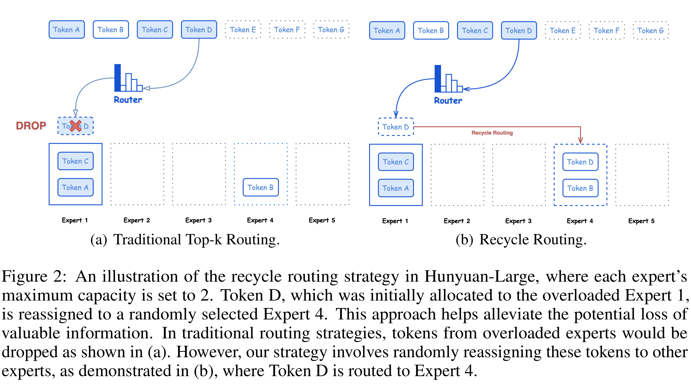

# Hunyuan-Large: An Open-Source MoE Model with 52 Billion Activated Parameters by Tencent

[Official source](https://github.com/Tencent-Hunyuan/Tencent-Hunyuan-Large)

## Abstract

In this paper, we introduce Hunyuan-Large, which is currently the largest open-source Transformer-based mixture of experts model, with a total of 389 billion parameters and 52 billion activation parameters, capable of handling up to 256K tokens. We conduct a thorough evaluation of Hunyuan-Large’s superior performance across various benchmarks including language understanding and generation, logical reasoning, mathematical problem-solving, coding, long-context, and aggregated tasks, where it outperforms LLama3.1-70B and exhibits comparable performance when compared to the significantly larger LLama3.1-405B model. Key practice of Hunyuan-Large include large-scale synthetic data that is orders larger than in previous literature, a mixed expert routing strategy, a key-value cache compression technique, and an expert-specific learning rate strategy. Additionally, we also investigate the scaling laws and learning rate schedule of mixture of experts models, providing valuable insights and guidances for future model development and optimization. The code and checkpoints of Hunyuan-Large are released to facilitate future innovations and applications. Code: https://github.com/Tencent/Tencent-Hunyuan-Large Models: https://huggingface.co/tencent/Tencent-Hunyuan-Large

Figure 2: An illustration of the recycle routing strategy in Hunyuan-Large, where each expert’s maximum capacity is set to 2. Token D, which was initially allocated to the overloaded Expert 1, is reassigned to a randomly selected Expert 4. This approach helps alleviate the potential loss of valuable information. In traditional routing strategies, tokens from overloaded experts would be dropped as shown in (a). However, our strategy involves randomly reassigning these tokens to other experts, as demonstrated in (b), where Token D is routed to Expert 4.

p. 6
