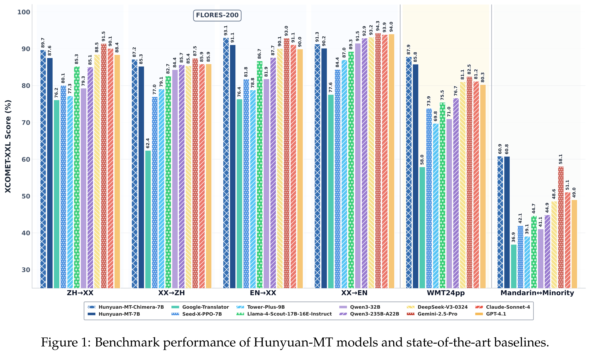

# Hunyuan-MT Technical Report

[Official source](https://github.com/Tencent-Hunyuan/Hunyuan-MT)

## Abstract

In this report, we introduce Hunyuan-MT-7B, our first open-source multilingual translation model, which supports bidirectional translation across 33 major languages and places a special emphasis on translation between Mandarin and several ethnic minority languages as well as dialects. Furthermore, to serve and address diverse translation scenarios and enhance model performance at test time, we introduce Hunyuan-MT-Chimera-7B, a translation model inspired by the slow thinking mode. This model integrates multiple outputs generated by the Hunyuan-MT-7B model under varying parameter settings, thereby achieving performance superior to that of conventional slow-thinking models based on Chain-of-Thought (CoT). The development of our models follows a holistic training process specifically engineered for multilingual translation, which begins with general and MT-oriented pre-training to build foundational capabilities, proceeds to Supervised Fine-Tuning (SFT) for task-specific adaptation, and culminates in advanced alignment through Reinforcement Learning (RL) and weak-to-strong RL. Through comprehensive experimentation, we demonstrate that both Hunyuan-MT-7B and Hunyuan-MT-Chimera-7B significantly outperform all translation-specific models of comparable parameter size and most of the SOTA large models, particularly on the task of translation between Mandarin and minority languages as well as dialects. In the WMT2025 shared task (General Machine Translation), our models demonstrate state-of-the-art performance, ranking first in 30 out of 31 language pairs. This result highlights the robustness of our models across a diverse linguistic spectrum, encompassing high-resource languages such as Chinese, English, and Japanese, as well as low-resource languages including Czech, Marathi, Estonian, and Icelandic. Hunyuan-MT-7B: https://huggingface.co/tencent/Hunyuan-MT-7B Hunyuan-MT-Chimera-7B: https://huggingface.co/tencent/Hunyuan-MT-Chimera-7B Code Repository: https://github.com/Tencent-Hunyuan/Hunyuan-MT

Figure 1: Benchmark performance of Hunyuan-MT models and state-of-the-art baselines.

p. 1
