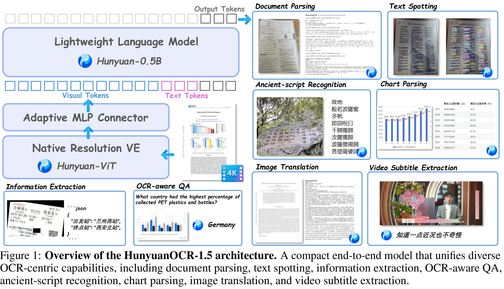

# HunyuanOCR-1.5: Making Lightweight OCR VLMs Faster and Better

[Official source](https://github.com/Tencent-Hunyuan/HunyuanOCR)

## Abstract

We present HunyuanOCR-1.5, a lightweight and end-to-end OCR-specialized vision-language model. HunyuanOCR targets a broad range of text-centric visual tasks, unifying document parsing, text spotting, information extraction, text-image translation, and multi-image document understanding within a single end-to-end VLM. Building upon the validated lightweight architecture of HunyuanOCR-1.0, HunyuanOCR-1.5 does not redesign the model backbone, but instead performs a systematic upgrade around two goals: making the model faster and better. For efficiency, we adapt DFlash inference acceleration to OCR decoding, significantly reducing the decoding latency of long structured outputs such as dense documents, tables, and formulas while preserving the output distribution. Powered by DFlash, HunyuanOCR-1.5 achieves a 6.37× speedup in Transformer inference and a 2.14× speedup under vLLM, delivering the fastest inference speed among all lightweight OCR VLMs. For capability, we propose Agentic Data Flow, an agent-driven data construction system that transforms model weaknesses into executable data requirements and autonomously performs material search, quality verification, and data pipeline development. Through this framework, we significantly enhance the model’s long-tail capabilities across ancient-script OCR, fine-grained chart and table parsing, multi-image text-centric QA, low-resource multilingual parsing, and document hallucination evaluation. Crucially, HunyuanOCR-1.5 stands as the top-tier end-to-end OCR solution on OmniDocBench v1.6, paired with unrivaled inference efficiency and new performance milestones across the aforementioned long-tail domains. Combined with an upgraded pretraining and post-training recipe, HunyuanOCR-1.5 further extends the capability boundary of the model in high-resolution, long-context, and multi-task scenarios. We characterize these upgrades through a capability-oriented evaluation, and experiments show that HunyuanOCR-1.5 achieves both faster inference and broader OCR capability coverage while retaining the deployment advantages of a lightweight end-to-end model. We will release the model weights and training code to the community to promote the research, reproduction, and real-world application of OCR-specialized vision-language models.

Figure 1: Overview of the HunyuanOCR-1.5 architecture. A compact end-to-end model that unifies diverse OCR-centric capabilities, including document parsing, text spotting, information extraction, OCR-aware QA, ancient-script recognition, chart parsing, image translation, and video subtitle extraction.

p. 4
