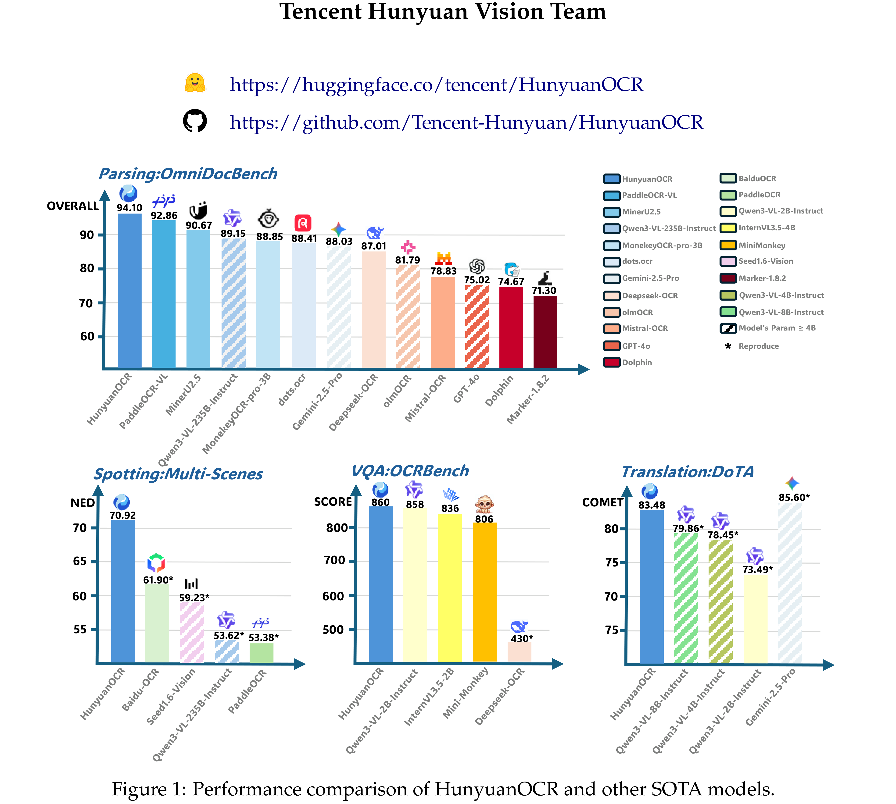

# HunyuanOCR Technical Report

[Official source](https://github.com/Tencent-Hunyuan/HunyuanOCR)

## Abstract

This paper presents HunyuanOCR, a commercial-grade, open-source, and lightweight (1B parameters) Vision-Language Model (VLM) dedicated to OCR tasks. The architecture comprises a Native Vision Transformer (ViT) and a lightweight LLM connected via an MLP adapter. HunyuanOCR demonstrates superior performance, outperforming commercial APIs, traditional pipelines, and larger models (e.g., Qwen3-VL-4B). Specifically, it surpasses current public solutions in perception tasks (Text Spotting, Parsing) and excels in semantic tasks (IE, Text Image Translation), securing first place in the ICDAR 2025 DIMT Challenge (Small Model Track). Furthermore, it achieves state-of-the-art (SOTA) results on OCRBench among VLMs with fewer than 3B parameters. HunyuanOCR achieves breakthroughs in three key aspects: 1) Unifying Versatility and Efficiency: We implement comprehensive support for core capabilities, including spotting, parsing, IE, VQA, and translation within a lightweight framework. This addresses the limitations of narrow “OCR expert models” and inefficient “General VLMs”. 2) Streamlined End-to-End Architecture: Adopting a pure end-to-end paradigm eliminates dependencies on pre-processing modules (e.g., layout analysis). This fundamentally resolves error propagation common in traditional pipelines and simplifies system deployment. 3) Data-Driven and RL Strategies: We confirm the critical role of high-quality

data and, for the first time in the industry, demonstrate that Reinforcement Learning (RL) strategies yield significant performance gains in OCR tasks. HunyuanOCR is officially open-sourced on HuggingFace. We also provide a high-performance deployment solution based on vLLM, placing its production efficiency in the top tier. We hope this model will advance frontier research and provide a solid foundation for industrial applications.

Figure 1: Performance comparison of HunyuanOCR and other SOTA models.

p. 1
