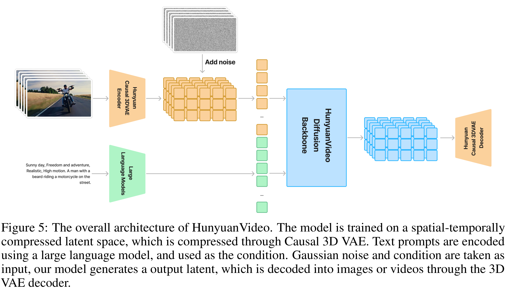

# HunyuanVideo: A Systematic Framework For Large Video Generative Models

[Official source](https://github.com/Tencent-Hunyuan/HunyuanVideo)

## Abstract

Recent advancements in video generation have profoundly transformed daily life for individuals and industries alike. However, the leading video generation models remain closed-source, creating a substantial performance disparity in video generation capabilities between the industry and the public community. In this report, we present HunyuanVideo, a novel open-source video foundation model that exhibits performance in video generation that is comparable to, if not superior to, leading closed-source models. HunyuanVideo features a comprehensive framework that integrates several key contributions, including data curation, advanced architecture design, progressive model scaling and training, and an efficient infrastructure designed to facilitate large-scale model training and inference. With those, we successfully trained a video generative model with over 13 billion parameters, making it the largest among all open-source models. We conducted extensive experiments and implemented a series of targeted designs to ensure high visual quality, motion dynamics, text-video alignment, and advanced filming techniques. According to professional human evaluation results, HunyuanVideo outperforms previous state-of-the-art models, including Runway Gen-3, Luma 1.6, and 3 top performing Chinese video generative models. By releasing the code of the foundation model and its applications, we aim to bridge the gap between closed-source and open-source communities. This initiative will empower everyone in the community to experiment with their ideas, fostering a more dynamic and vibrant video generation ecosystem. The code is publicly available at https://github.com/Tencent/HunyuanVideo.

Figure 5: The overall architecture of HunyuanVideo. The model is trained on a spatial-temporally compressed latent space, which is compressed through Causal 3D VAE. Text prompts are encoded using a large language model, and used as the condition. Gaussian noise and condition are taken as input, our model generates a output latent, which is decoded into images or videos through the 3D VAE decoder.

p. 5
