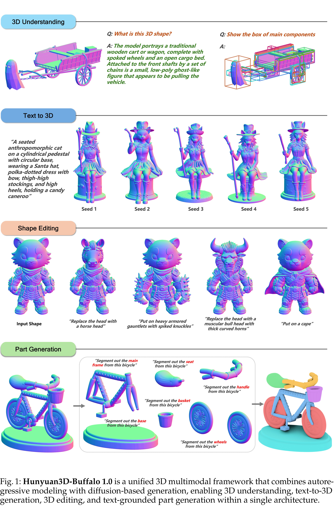

# Hunyuan3D-Buffalo 1.0: A Unified Multimodal Model for Scalable 3D Generation, Understanding, and Editing

[Official source](https://arxiv.org/abs/2608.02711)

## Abstract

Recent advances in image generation have demonstrated the potential of unified multimodal models that integrate understanding, generation, and editing. However, unified 3D modeling remains constrained by scarce multimodal data, particularly the lack of large-scale and geometrically consistent editing data. To address this limitation, we propose Hunyuan3D-Buffalo 1.0, a unified framework supporting 3D understanding, text-to-3D generation, instruction-guided 3D editing, and text-grounded part generation within a single architecture. To enable scalable training, we construct an 87M-scale 3D multimodal corpus, comprising 25M understanding samples, 50M text-to-3D pairs, and 12M editing pairs generated using Nano3D-v2. Architecturally, the framework combines Hunyuan3D-VLM for semantic, structural, and spatial understanding with Hunyuan3D DiT for high-fidelity 3D synthesis. The VLM provides multimodal semantic conditions for generation, while editing and part generation additionally condition the diffusion process on the source object representation to preserve its overall structure and unedited regions. Extensive experiments show that Hunyuan3D-Buffalo 1.0 achieves state-of-the-art or leading performance on text-to-3D generation and 3D editing benchmarks, while exhibiting strong understanding and part-generation capabilities. Our analysis further shows that both generation and understanding improve editing, demonstrating the effectiveness of unified 3D multimodal training.

Fig. 1: Hunyuan3D-Buffalo 1.0 is a unified 3D multimodal framework that combines autore-gressive modeling with diffusion-based generation, enabling 3D understanding, text-to-3D generation, 3D editing, and text-grounded part generation within a single architecture.

p. 2
