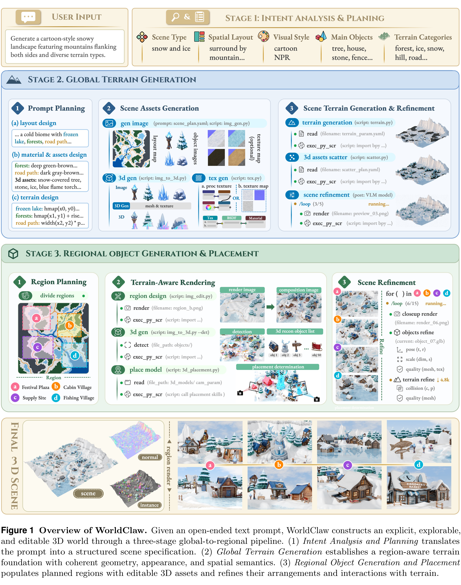

# WorldClaw: Agentic 3D Open-World Generation at Scale

[Official source](https://arxiv.org/abs/2608.05248)

## Abstract

Generating large-scale, freely explorable 3D worlds from open-ended text remains challenging because a system must jointly maintain global spatial coherence, rich local content, and explicit assets suitable for downstream editing and reuse. We present WorldClaw, a fully agentic, coarse-to-fine framework for open-world 3D scene generation. Planning agents translate a text prompt into a structured specification of regions, terrain, assets, materials, and spatial relations. WorldClaw then builds a globally coherent terrain foundation from semantic layouts, reusable assets, generative or procedural materials, and a region-aware height field. For detail-demanding regions, it generates terrain-conditioned compositions, reconstructs editable textured meshes, and recovers their placement on the terrain; render-based agents further refine terrain, objects, appearance, and contacts. Across diverse open-world prompts, WorldClaw produces large-scale scenes with coherent spatial organization, visually compelling local content, and editable instance-level assets while preserving a consistent global terrain structure.

Figure 1 Overview of WorldClaw. Given an open-ended text prompt, WorldClaw constructs an explicit, explorable, and editable 3D world through a three-stage global-to-regional pipeline. (1) Intent Analysis and Planning translates the prompt into a structured scene specification. (2) Global Terrain Generation establishes a region-aware terrain foundation with coherent geometry, appearance, and spatial semantics. (3) Regional Object Generation and Placement populates planned regions with editable 3D assets and refines their arrangements and interactions with terrain.

p. 5
