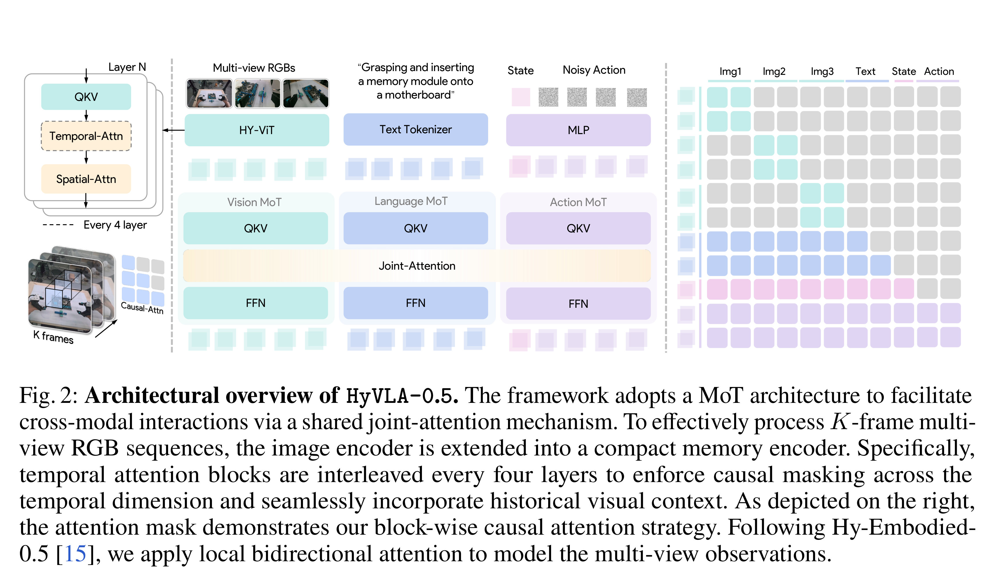
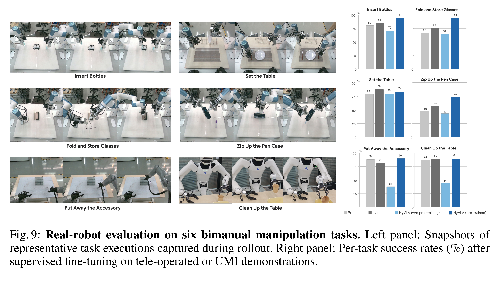

# Hy-Embodied-0.5-VLA: From Vision-Language-Action Models to a Real-World Robot Learning Stack

[Official source](https://arxiv.org/abs/2606.14409)

The past year has witnessed a rapid proliferation of Vision-Language-Action (VLA) models, with growing attention now turning to the next generation of embodied foundation models. However, a truly generalist robot is unlikely to emerge from any single model in isolation. Rather, it must be built on a full robot learning stack that remains robust from data collection to real-world deployment. In this report, we present Hy-Embodied-0.5-VLA, abbreviated as HyVLA-0.5, an end-to-end system that spans the full robot learning stack: data collection, model design, continued pre-training and supervised fine-tuning, RL post-training, and real-world deployment. Each component serves a distinct role in this stack. For data, we develop a custom fingertip UMI device with a motion-capture cage to collect over 10,000 hours of egocentric, sub-millimeter- precision human demonstrations that can also directly serve as post-training trajectories. For modeling, we extend the Hy-Embodied-0.5 backbone with a flow-matching action expert, a compact memory encoder, and a delta-chunk action representation that decouples policy learning from embodiment-specific kinematics. For continued pre-training and fine-tuning, starting from the checkpoint continued-pre-trained on the UMI corpus, we introduce two real-robot SFT tracks: Track-A for target-robot adaptation and Track-B for UMI-only cross-embodiment transfer. For RL post-training, we introduce a Proximalized Preference Optimization (PRO)-based offline RL algorithm that turns failure cases into rapid policy improvement and drives performance toward near-ceiling success rates without requiring a learned reward model. For deployment, an asynchronous inference pipeline with lightweight trajectory smoothing enables high-frequency closed-loop control. Taken as a whole, the Hy-Embodied-0.5-VLA stack marks a meaningful step toward deployable generalist robots.

Website: tairos.tencent.com/openSourceModels/hy-embodied-0.5-vla Github: github.com/Tencent-Hunyuan/Hy-Embodied-0.5-VLA Model: huggingface.co/tencent/Hy-Embodied-0.5-VLA-UMI Dataset: huggingface.co/datasets/tencent/Hy-Embodied-0.5-VLA-Data

Fig. 2: Architectural overview of HyVLA-0.5. The framework adopts a MoT architecture to facilitate cross-modal interactions via a shared joint-attention mechanism. To effectively process K-frame multi- view RGB sequences, the image encoder is extended into a compact memory encoder. Specifically, temporal attention blocks are interleaved every four layers to enforce causal masking across the temporal dimension and seamlessly incorporate historical visual context. As depicted on the right, the attention mask demonstrates our block-wise causal attention strategy. Following Hy-Embodied- 0.5 [15], we apply local bidirectional attention to model the multi-view observations.

p. 3

Fig. 9: Real-robot evaluation on six bimanual manipulation tasks. Left panel: Snapshots of representative task executions captured during rollout. Right panel: Per-task success rates (%) after supervised fine-tuning on tele-operated or UMI demonstrations.

p. 15
