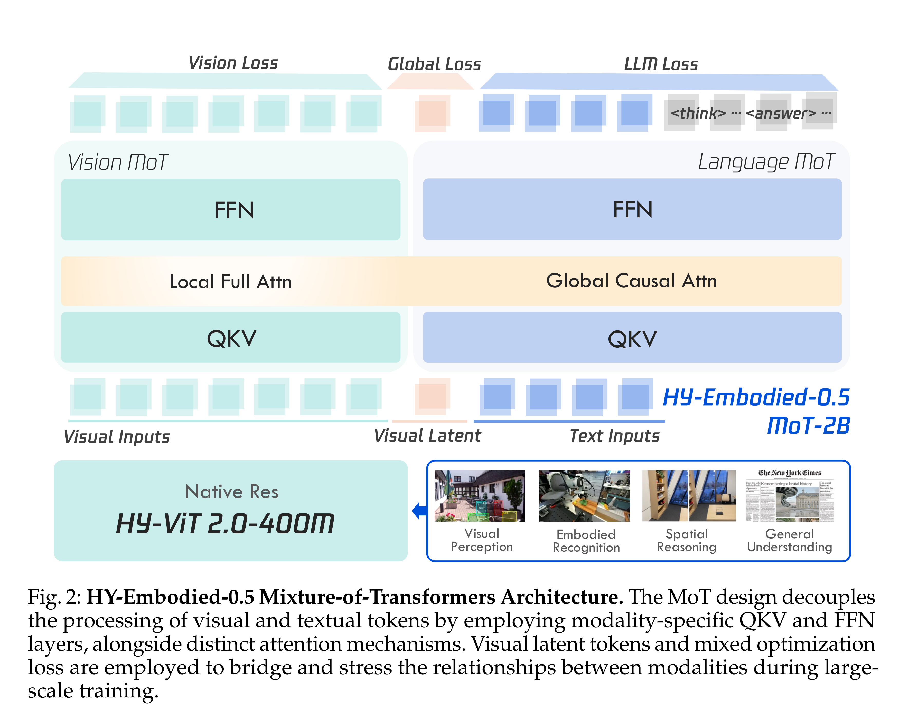
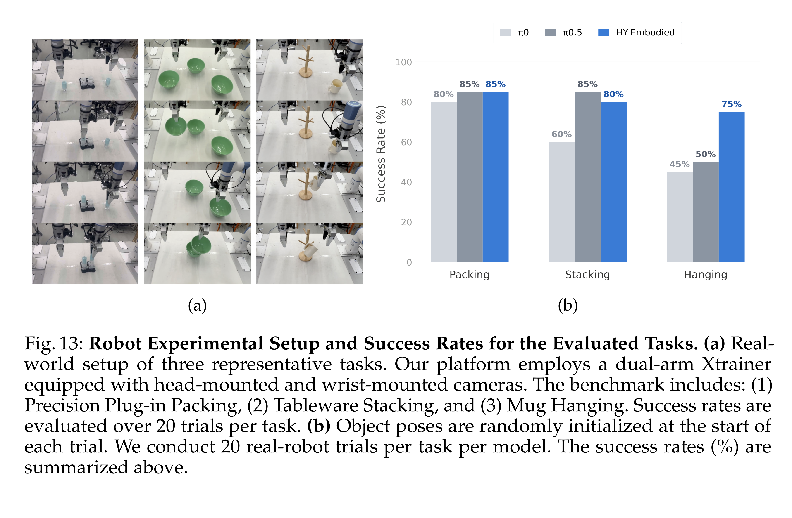

# HY-Embodied-0.5: Embodied Foundation Models for Real-World Agents

[Official source](https://arxiv.org/abs/2604.07430)

## Abstract

We introduce HY-Embodied-0.5, a family of foundation models specifically designed for real-world embodied agents. To bridge the gap between general Vision-Language Models (VLMs) and the demands of embodied agents, our models are developed to enhance the core capabilities required by embodied intelligence: spatial and temporal visual perception, alongside advanced embodied reasoning for prediction, interaction, and planning. The HY-Embodied-0.5 suite comprises two primary variants: an efficient model with 2B activated parameters designed for edge deployment, and a powerful model with 32B activated parameters targeted for complex reasoning. To support the fine-grained visual perception essential for embodied tasks, we adopt a Mixture-of-Transformers (MoT) architecture to enable modality-specific computing. By incorporating latent tokens, this design effectively enhances the perceptual representation of the models. To improve reasoning capabilities, we introduce an iterative, self-evolving post-training paradigm. Furthermore, we employ on-policy distillation to transfer the advanced capabilities of the large model to the smaller variant, thereby maximizing the performance potential of the compact model. Extensive evaluations across 22 benchmarks, spanning visual perception, spatial reasoning, and embodied understanding, demonstrate the effectiveness of our approach. Our MoT-2B model outperforms similarly sized state-of-the-art models on 16 benchmarks, while the 32B variant achieves performance comparable to frontier models such as Gemini 3.0 Pro. In downstream robot control experiments, we leverage our robust VLM foundation to train an effective Vision-Language-Action (VLA) model, achieving compelling results in real-world physical evaluations. Code and models are open-sourced at https://github.com/Tencent-Hunyuan/HY-Embodied.

Fig. 2: HY-Embodied-0.5 Mixture-of-Transformers Architecture. The MoT design decouples the processing of visual and textual tokens by employing modality-specific QKV and FFN layers, alongside distinct attention mechanisms. Visual latent tokens and mixed optimization loss are employed to bridge and stress the relationships between modalities during large-scale training.

p. 5

Fig. 13: Robot Experimental Setup and Success Rates for the Evaluated Tasks. (a) Real-world setup of three representative tasks. Our platform employs a dual-arm Xtrainer equipped with head-mounted and wrist-mounted cameras. The benchmark includes: (1) Precision Plug-in Packing, (2) Tableware Stacking, and (3) Mug Hanging. Success rates are evaluated over 20 trials per task. (b) Object poses are randomly initialized at the start of each trial. We conduct 20 real-robot trials per task per model. The success rates (%) are summarized above.

p. 23
