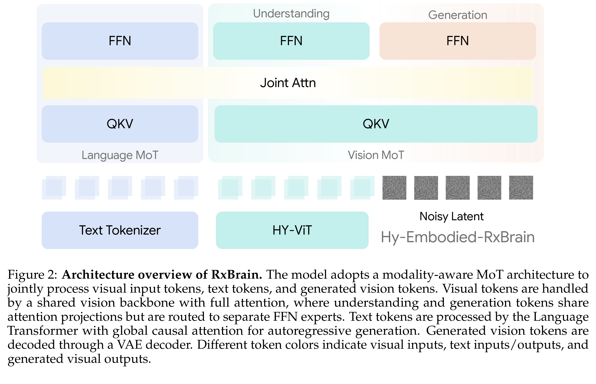
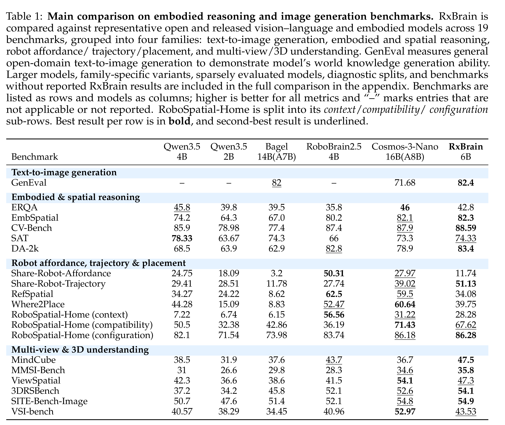

# RxBrain: Embodied Cognition Foundation Model with Joint Language-Visual Reasoning and Imagination

[Official source](https://arxiv.org/abs/2607.14187)

## Abstract

Embodied cognition requires agents to connect high-level task reasoning with the physical states to be achieved. We introduce Hy-Embodied-RxBrain, an embodied cognition foundation model with joint language-visual reasoning and imagination. Unlike vision-language models that emphasize scene understanding and textual decision making, or generative world models that mainly predict future visual states, RxBrain represents embodied plans in a single planning sequence where language and visual imagination play complementary roles. Language provides the abstract structure of a plan, including task decomposition, planning primitives, constraints, temporal order, and decision logic, while visual imagination grounds this structure through world state prediction and joint subgoal planning, associating each planning step with intermediate and final physical states. RxBrain adopts a unified multimodal Mixture-of-Transformers architecture that supports language, image, and video understanding and generation within one model. To train this capability, we build an automatic pipeline that converts embodied videos into joint text-visual planning supervision by decomposing videos into planning steps and aligning them with visual state transitions. We further introduce RxBrain-Bench to evaluate whether models can represent embodied plans through joint textual and visual components rather than separate understanding or generation. Experiments show that RxBrain maintains embodied understanding and generation abilities, and produces plans with coupled textual reasoning, world state prediction, and joint subgoal planning. We also extend RxBrain to continuous robot action generation, where it shows promising real-robot performance without large-scale action-data pretraining. These results provide an initial step toward foundation models for embodied cognition.

## 4.2 Training Stage

RxBrain is trained with a two-stage curriculum that progressively transforms the model from a general multimodal foundation model into an unified embodied model with joint language-visual reasoning and imagination abilities. The first stage focuses on establishing a unified vision-language generation capability, where the model learns to understand, reason over, and generate visual content while pre- serving the underlying language capability.

p. 12

Figure 2: Architecture overview of RxBrain. The model adopts a modality-aware MoT architecture to jointly process visual input tokens, text tokens, and generated vision tokens. Visual tokens are handled by a shared vision backbone with full attention, where understanding and generation tokens share attention projections but are routed to separate FFN experts. Text tokens are processed by the Language Transformer with global causal attention for autoregressive generation. Generated vision tokens are decoded through a VAE decoder. Different token colors indicate visual inputs, text inputs/outputs, and generated visual outputs.

p. 5

Table 1: Main comparison on embodied reasoning and image generation benchmarks. RxBrain is compared against representative open and released vision–language and embodied models across 19 benchmarks, grouped into four families: text-to-image generation, embodied and spatial reasoning, robot affordance/ trajectory/placement, and multi-view/3D understanding. GenEval measures general open-domain text-to-image generation to demonstrate model’s world knowledge generation ability. Larger models, family-specific variants, sparsely evaluated models, diagnostic splits, and benchmarks without reported RxBrain results are included in the full comparison in the appendix. Benchmarks are listed as rows and models as columns; higher is better for all metrics and “–” marks entries that are not applicable or not reported. RoboSpatial-Home is split into its context/compatibility/ configuration sub-rows. Best result per row is in bold, and second-best result is underlined.

p. 16
