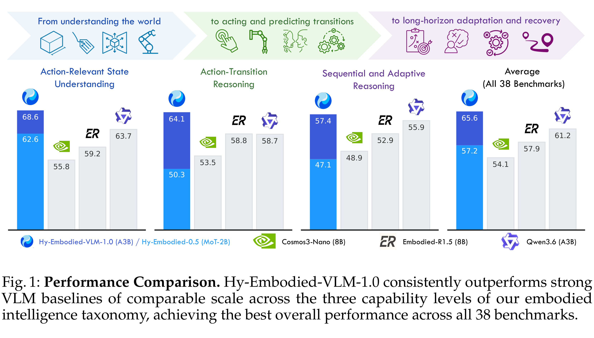
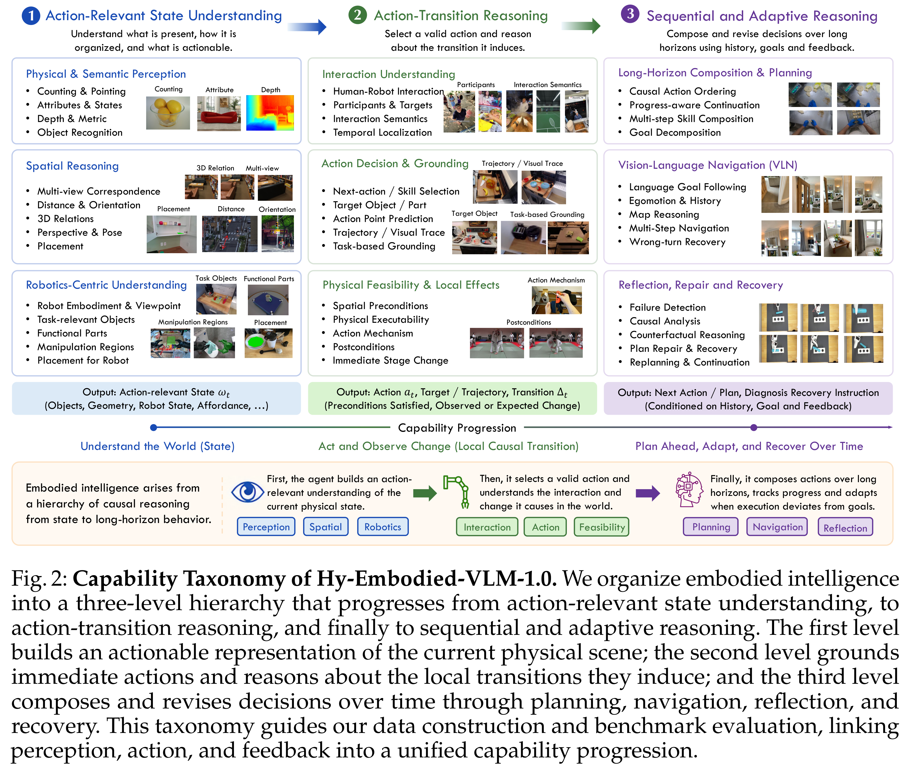

# Hy-Embodied-VLM-1.0: Efficient Physical-World Agents

[Official source](https://arxiv.org/abs/2607.12894)

Building capable embodied agents requires not only multimodal perception and understanding, but also agentic capabilities for reasoning about actions, adapting to evolving situations, and interacting with the physical world. In this report, we introduce Hy-Embodied-VLM-1.0, an efficient and powerful embodied foundation model specifically designed for embodied agents operating in the physical world. To cultivate such capabilities from the pre-training stage onward, we define an action-centric capability taxonomy comprising three progressive dimensions: Action-Relevant State Understanding, Action–Transition Reasoning, and Sequential and Adaptive Reasoning. Guided by this taxonomy, we develop a systematic data pipeline and curate data mixtures spanning both pre-training and post-training. To deliver strong physical-world understanding and interaction capabilities while supporting latency-sensitive deployment, we build our model on the Hy3-A3B language backbone and the Hy-ViT2 vision encoder. Its efficient Mixture-of-Experts architecture combines strong model capacity with high inference efficiency. We evaluate Hy-Embodied-VLM-1.0 on a comprehensive suite of 38 benchmarks covering embodied perception, physical-world understanding, and embodied reasoning. The model achieves the best performance among similarly sized models on 19 of the 38 benchmarks and substantially outperforms strong competitors, including Qwen3.6-A3B and Cosmos 3. Compared with the previous-generation Hy-Embodied-0.5 MoT-2B, Hy-Embodied-VLM-1.0 improves average performance by 8.4%. Despite activating only 3B parameters, it achieves performance close to that of the previous-generation model with 32B activated parameters. Beyond static benchmark evaluation, Hy-Embodied-VLM-1.0 also demonstrates strong performance on embodied agentic tasks requiring multi-turn interaction and long-horizon reasoning.

Github: github.com/Tencent-Hunyuan/HY-Embodied Model: huggingface.co/tencent/Hy-Embodied-VLM-1.0

Fig. 1: Performance Comparison. Hy-Embodied-VLM-1.0 consistently outperforms strong VLM baselines of comparable scale across the three capability levels of our embodied intelligence taxonomy, achieving the best overall performance across all 38 benchmarks.

p. 1

Fig. 2: Capability Taxonomy of Hy-Embodied-VLM-1.0. We organize embodied intelligence into a three-level hierarchy that progresses from action-relevant state understanding, to action-transition reasoning, and finally to sequential and adaptive reasoning. The first level builds an actionable representation of the current physical scene; the second level grounds immediate actions and reasons about the local transitions they induce; and the third level composes and revises decisions over time through planning, navigation, reflection, and recovery. This taxonomy guides our data construction and benchmark evaluation, linking perception, action, and feedback into a unified capability progression.

p. 4
