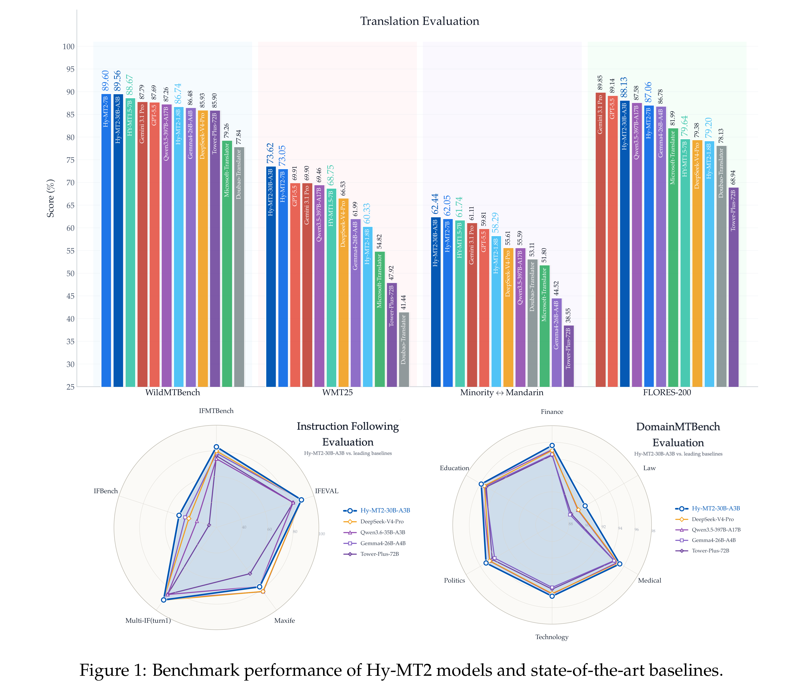
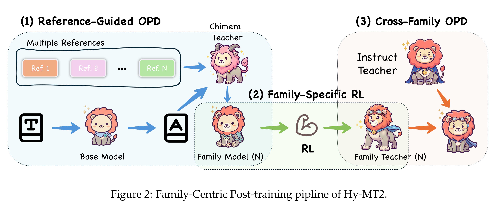

# Hy-MT2: A Family of Fast, Efficient and Powerful Multilingual Translation Models in the Wild

[Official source](https://arxiv.org/abs/2605.22064)

## Abstract

Hy-MT2 is a family of fast-thinking multilingual translation models designed for com- plex real-world scenarios. It includes three model sizes: 1.8B, 7B, and 30B-A3B (MoE), all of which support translation among 33 languages and effectively follow translation instructions in multiple languages. Multi-dimensional evaluations show that Hy-MT2 delivers outstanding performance across general, real-world business, domain-specific, and instruction-following translation tasks. The 7B and 30B models outperform open- source models such as DeepSeek-V4-Pro and Kimi K2.6 in fast-thinking mode, while the lightweight 1.8B model also surpasses mainstream commercial APIs from providers such as Microsoft and Doubao overall. Moreover, when paired with AngelSlim’s 1.25- bit extreme quantization for on-device deployment, the lightweight 1.8B model requires only 440 MB of storage and achieves a 1.5× inference speedup. https://huggingface.co/collections/tencent/hy-mt2 https://github.com/Tencent-Hunyuan/Hy-MT2

Figure 1: Benchmark performance of Hy-MT2 models and state-of-the-art baselines.

p. 1

Figure 2: Family-Centric Post-training pipline of Hy-MT2.

p. 4
