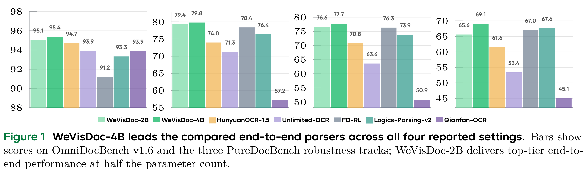
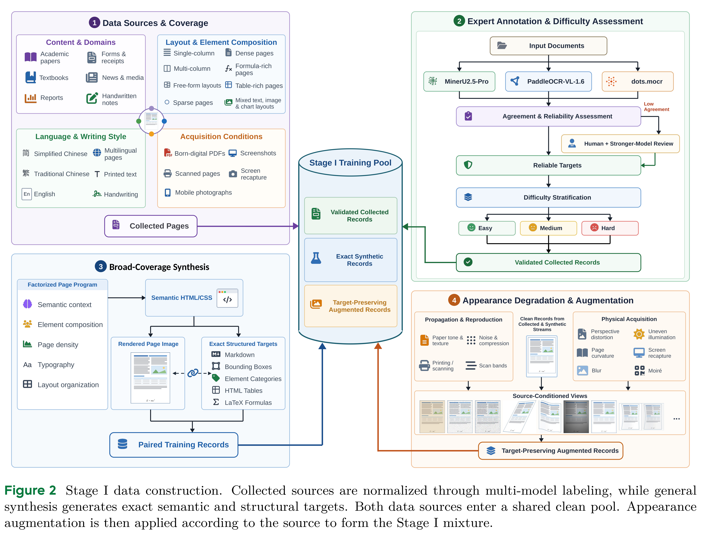

# WeVisDoc: From Coverage to Capability for Robust End-to-End Document Parsing

[Official source](https://huggingface.co/tencent/WeVisDoc-4B)

## Abstract

Document parsing converts document images into structured content and requires reliable performance across diverse layouts and acquisition conditions. Yet training corpora are biased toward common document types and clean digital pages, while expanding coverage alone does not specify how to address a parser’s remaining weaknesses. We present WeVisDoc, a two-stage data-centric framework for robust end-to-end document parsing. Stage I broadens semantic, structural, and appearance coverage through heterogeneous data and structure-preserving degradation synthesis. Stage II uses a held-out probe to measure the Stage I parser’s residual errors within fixed visual–structural clusters. These diagnostics guide targeted data construction and reallocation of the target-token budget. WeVisDoc-4B achieves an Overall score of 95.38 on OmniDocBench v1.6 and a mean Overall score of 75.54 across the three PureDocBench tracks, ranking first among the compared end-to-end parsers in all four settings. Compared with Stage I, Stage II improves Overall scores for the 2B and 4B models on both benchmarks, with larger gains on the degraded PureDocBench tracks, including a 4.03-point gain for the 4B model on the Real Degraded track.

## Method

Our method first builds broad data coverage, then adds data and adjusts training to address remaining parsing errors. Section 3.1 defines the task and training objective; Sections 3.2 and 3.3 describe the two stages, and Section 3.4 gives the experimental configuration. 3.1 Task Formulation and Method Overview Unified document parsing.

p. 4

Figure 1 WeVisDoc-4B leads the compared end-to-end parsers across all four reported settings. Bars show scores on OmniDocBench v1.6 and the three PureDocBench robustness tracks; WeVisDoc-2B delivers top-tier end-to-end performance at half the parameter count.

p. 1

Figure 2 Stage I data construction. Collected sources are normalized through multi-model labeling, while general synthesis generates exact semantic and structural targets. Both data sources enter a shared clean pool. Appearance augmentation is then applied according to the source to form the Stage I mixture.

p. 6
