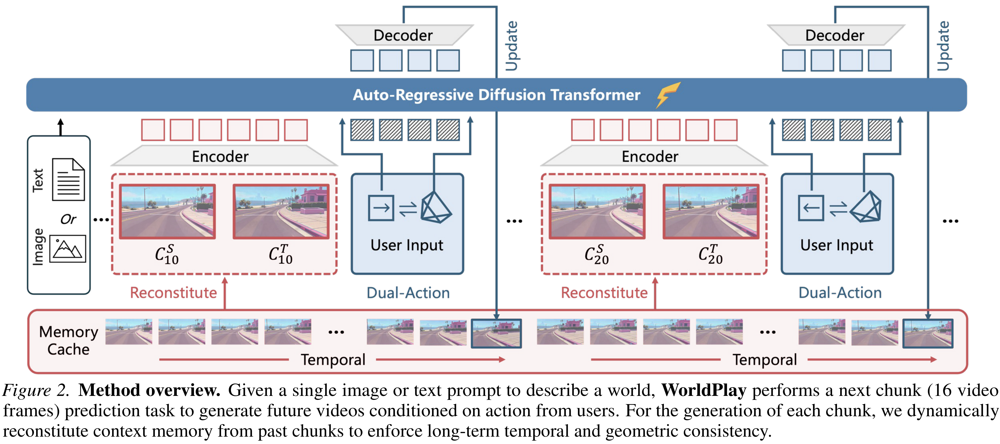
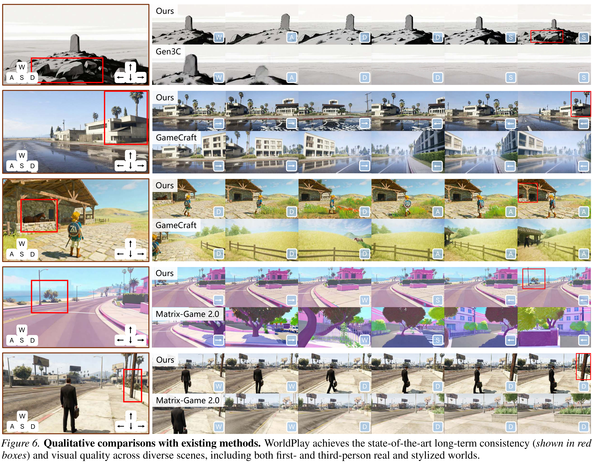

# WorldPlay: Towards Long-Term Geometric Consistency for Real-Time Interactive World Modeling

[Official source](https://arxiv.org/abs/2512.14614)

## Abstract

This paper presents WorldPlay, a streaming video diffusion model that enables real-time, interactive world modeling with long-term geometric consistency, resolving the trade-off between speed and memory that limits current methods. WorldPlay draws power from three key ingredients. 1) We use a Dual Action Representation to enable robust action control in response to the user’s keyboard and mouse inputs. 2) To enforce long-term consistency, our Reconstituted Context Memory dynamically rebuilds context from past frames and uses tem- poral reframing to keep geometrically important but long-past frames accessible, effectively allevi- ating memory attenuation. 3) We also propose Context Forcing, a novel distillation method designed for memory-aware model. Aligning memory context between the teacher and student preserves the student’s capacity to use long-range information, enabling real-time speeds while preventing error drift. Taken together, WorldPlay generates long-horizon streaming 720p video at 24 FPS with superior consistency, comparing favorably with existing techniques and showing strong generalization across diverse scenes. Project page and online demo can be found: https://3d-models.hunyuan.tencent.com/world/ and https://3d.hunyuan.tencent.com/sceneTo3D.

Figure 2. Method overview. Given a single image or text prompt to describe a world, WorldPlay performs a next chunk (16 video frames) prediction task to generate future videos conditioned on action from users. For the generation of each chunk, we dynamically reconstitute context memory from past chunks to enforce long-term temporal and geometric consistency.

p. 4

Figure 6. Qualitative comparisons with existing methods. WorldPlay achieves the state-of-the-art long-term consistency ( shown in red boxes ) and visual quality across diverse scenes, including both first- and third-person real and stylized worlds.

p. 7
